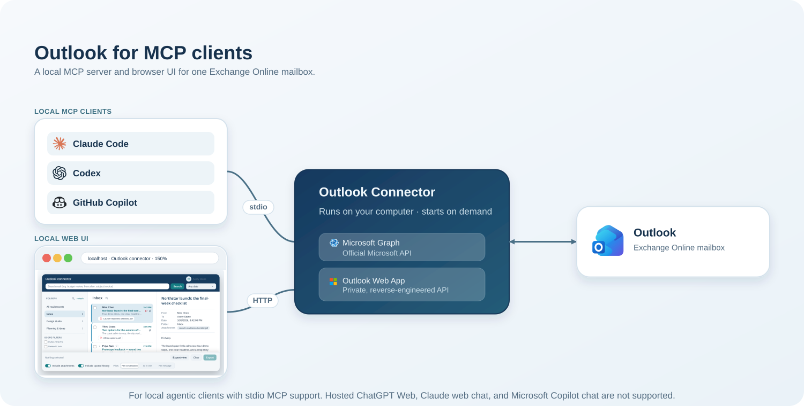
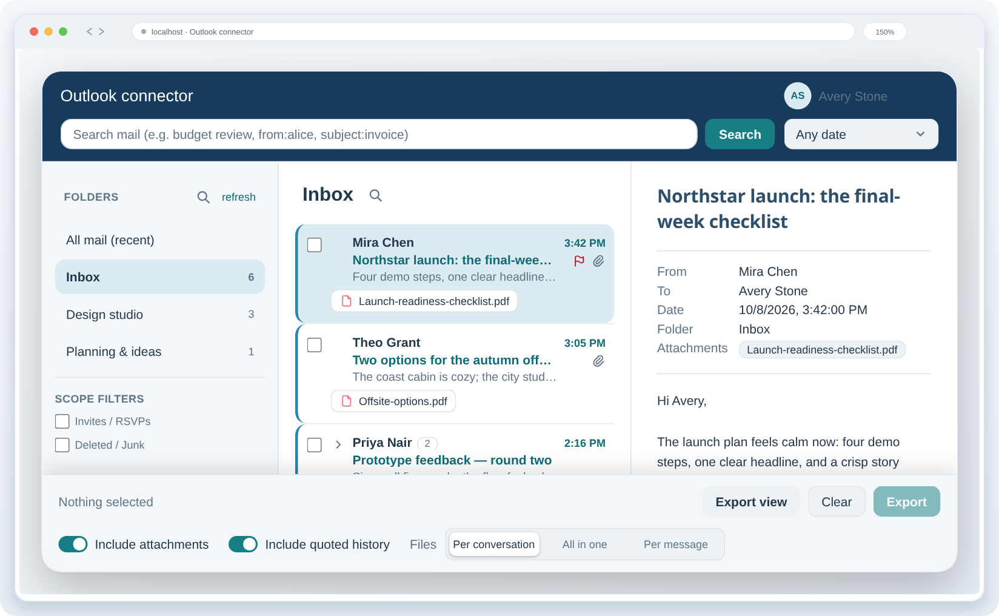

# Outlook for MCP clients

A local MCP server and browser UI for one user’s Exchange Online mailbox.

- Find messages by subject and contents, then read messages and full conversations.
- Export conversations, messages, or a folder/date window with attachments.
- Draft and send email, manage mailbox rules, and organize messages.
- Browse folders, read messages, and download attachments in the local UI.



## Requirements

- Install [uv](https://docs.astral.sh/uv/getting-started/installation/).
- Use an Exchange Online mailbox.

A separate Python installation is optional: uv selects an installed Python 3.12 or newer, or installs a managed version when needed.

## Setup

```bash
uv sync --locked
uv run outlook-connector auth
uv run outlook-connector status
```

Run the `auth` command above and it logs you in. All `lrh-*` products share the same login engine, so one login covers them all.

Core mail reads, search, exports and attachment downloads use `outlook.graph`. The `outlook.api`
profile is also required for inbox-rule and native-signature reads, as well as to draft, send, change
mailbox state or manage signature settings. `outlook.graph` requests Graph `Mail.Read` for mailbox
data and `User.Read` for the signed-in profile and photo.

The encrypted shared cache lives under `~/.lrh-m365-auth` by default; set `M365_AUTH_HOME` to use a
different shared location. It holds one active Microsoft account for all three connectors. To switch
accounts, sign out of the shared cache and sign in again:

```bash
uv run outlook-connector auth --sign-out
uv run outlook-connector auth
```

`uv run outlook-connector status` reads local profile state without network requests. It reports
cached client credentials and any matching resource access-token expiry. Profiles sharing one
client can have the same credential state even when only one resource token is cached.
`status --check` attempts token acquisition for every profile; it does not verify that each
Microsoft service or mailbox operation is authorized.

> Credentials are entered only on Microsoft's sign-in page. The application never sees them; tokens
> stay in the shared encrypted cache. If encryption is unavailable, authentication fails closed.

### Configure a local MCP client

Replace `/path/to/lrh-outlook-connector` with the absolute path to your clone.

**Claude Code** — add the server from a terminal:

```bash
claude mcp add --transport stdio lrh-outlook-connector -- uv run --directory /path/to/lrh-outlook-connector outlook-connector mcp
```

See the [Claude Code MCP guide](https://docs.anthropic.com/en/docs/claude-code/mcp).

**Codex CLI** — register the same stdio command:

```bash
codex mcp add lrh-outlook-connector -- uv run --directory /path/to/lrh-outlook-connector outlook-connector mcp
```

See the [Codex MCP guide](https://developers.openai.com/codex/mcp/).

**GitHub Copilot Chat in VS Code** — add this server to `.vscode/mcp.json` in your workspace:

```json
{
  "servers": {
    "lrh-outlook-connector": {
      "type": "stdio",
      "command": "uv",
      "args": [
        "run",
        "--directory",
        "/path/to/lrh-outlook-connector",
        "outlook-connector",
        "mcp"
      ]
    }
  }
}
```

Replace the sample path with your clone’s absolute path. In Windows JSON paths, escape backslashes (for example, `C:\\Users\\you\\lrh-outlook-connector`). This example requires Copilot Chat’s Agent mode with local MCP support; see [VS Code’s MCP guide](https://code.visualstudio.com/docs/copilot/chat/mcp-servers).

> **Client compatibility:** These examples require a locally running agentic client that can launch a stdio MCP server. Hosted ChatGPT Web, Claude web chat, Copilot web chat, and similar services cannot start this local process. This project does not provide a remote MCP endpoint; hosted clients require one to be deployed separately.

The UI opens in your browser and stops after 30 minutes without activity:

```bash
uv run outlook-connector ui
```



> The web UI is intended for manual message exports. The preview is plain text, not rendered HTML; it shows how extracted message content will appear in an export.

## MCP tools

The MCP server exposes the tools below. Each one's inputs, results and caveats are in [architecture §8](docs/architecture.md#8-surfaces-tools-and-endpoints).

| MCP tool | Service module | Behavior |
|---|---|---|
| `auth_status` | shared auth provider | Read cached account/client credentials and resource-token expiry |
| `list_folders` | [`service/mailbox.py`](src/outlook_connector/service/mailbox.py) | List reachable folders and counts |
| `list_messages` | [`service/mailbox.py`](src/outlook_connector/service/mailbox.py) | List messages in a folder or mailbox, with folder, date-window and scope filters |
| `search_messages` | [`service/mailbox.py`](src/outlook_connector/service/mailbox.py) | Search messages with folder, date-window and scope filters |
| `search_calendar_events` | [`service/calendar.py`](src/outlook_connector/service/calendar.py) | Search Exchange events online with bounded continuation and optional start-date bounds |
| `list_calendar_events` | [`service/calendar_listing.py`](src/outlook_connector/service/calendar_listing.py) | List the events overlapping a window in time order, Graph first; `contains` and descriptions need Graph |
| `get_calendar_event` | [`service/calendar.py`](src/outlook_connector/service/calendar.py) | Hydrate an event's agenda, attendees, join URL and attachment metadata |
| `get_conversation` | [`service/conversations.py`](src/outlook_connector/service/conversations.py) | Read a conversation using the requested scope |
| `get_message` | [`service/mailbox.py`](src/outlook_connector/service/mailbox.py) | Read a message body |
| `list_attachments` | [`service/files.py`](src/outlook_connector/service/files.py) | List attachment metadata, including inline image IDs |
| `download_attachment` | [`service/files.py`](src/outlook_connector/service/files.py) | Save an attachment locally |
| `save_message_mime` | [`service/files.py`](src/outlook_connector/service/files.py) | Save the original message as an .eml file |
| `export_messages` | [`service/export/`](src/outlook_connector/service/export/) | Export conversations, messages or a folder/date window |
| `list_rules`, `create_rule`, `update_rule`, `reorder_rules`, `delete_rule` | [`service/rules.py`](src/outlook_connector/service/rules.py) | Read rules or propose and confirm supported changes |
| `list_signatures`, `get_signature`, `create_signature`, `update_signature`, `delete_signature`, `set_default_signature` | [`service/signatures.py`](src/outlook_connector/service/signatures.py) | Read and manage native Outlook signatures |
| `create_draft`, `send_draft` | [`service/writes.py`](src/outlook_connector/service/writes.py) | Create drafts and send an existing draft |
| `set_read_state`, `set_flag`, `move_messages`, `delete_messages` | [`service/mutations.py`](src/outlook_connector/service/mutations.py) | Change read state, flags and message locations |

## Product boundaries

| Repository | Responsible for |
|---|---|
| [lrh-m365-auth](../lrh-m365-auth/README.md) | Shared Microsoft sign-in: one encrypted token cache and the profiles every connector uses |
| [lrh-outlook-connector](../lrh-outlook-connector/README.md) | Exchange mail, folders, drafts, rules, native signatures, and calendar events (schedule, agenda, attendees, Teams join link) |
| [lrh-teams-connector](../lrh-teams-connector/README.md) | Teams chats and channels, message attachments, and meeting chats, recordings, transcripts, recaps and notes |
| [lrh-sharepoint-connector](../lrh-sharepoint-connector/README.md) | General OneDrive and SharePoint file search and selected file retrieval (read-only) |

A calendar event stays with Outlook even when it links to a Teams meeting.

## Development

```bash
uv run ruff check .
uv run ruff format --check .
uv run pyright
uv run pytest
node --test tests/surfaces/message_reader.test.cjs
```

Project references: [requirements](docs/outlook-requirements-v4.md) · [architecture](docs/architecture.md) · [API research](docs/outlook-api-research.md) · [open roadmap](docs/outlook-roadmap.md).
