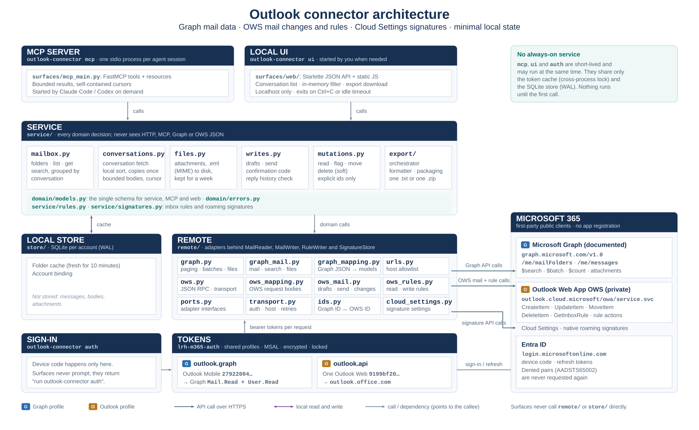
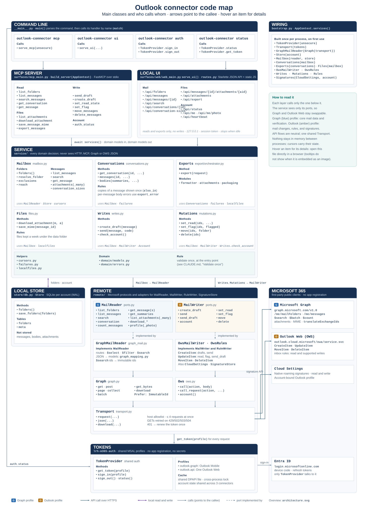

# Outlook Connector — Architecture

**Inputs:** [Requirements v4](outlook-requirements-v4.md) · [Roadmap](outlook-roadmap.md) · [API research](outlook-api-research.md)

The classes and who calls whom, in more detail: [code map](code-map.svg).

This document describes how the application is built: processes, layers, modules, data, and the main flows. *What* it must do is in v4. *Why* each API choice was made is in the research doc.

---

## 1. Principles

1. **Remote first.** Outlook's servers do the work: listing, filtering, search, conversation grouping. The app keeps locally only what the server cannot give back.
2. **No always-on service.** Every entry point is a short-lived local process started on demand, for one user. Several may run at once, and weeks may pass between runs. It is not designed to be hosted as a long-running MCP or HTTP server (§2).
3. **One domain implementation, thin surfaces.** The UI and MCP call the same service. Neither reimplements domain decisions.
4. **Protocol knowledge stays at the edge.** Only the [`remote/`](../src/outlook_connector/remote/) package knows URLs, Graph/OWS JSON, ID formats and paging. The service works with domain models.
5. **Documented first, gaps filled.** Prefer documented Graph capabilities when the endpoint and granted profile support the operation; use Outlook-specific services for the remaining capabilities. In the current wiring, Graph handles mail-data reads and read-after-write checks, OWS handles mail changes and inbox-rule access, and Cloud Settings handles native signature settings. The split depends on tenant grants and is swappable (§6).
6. **Small modules.** Each responsibility gets its own module from the start. Do not grow a 2,000-line connector or service.
7. **Current format only.** Follow [AGENTS.md](../AGENTS.md): no migrations or compatibility shims. Development databases are reset, not migrated.

## 2. Process model

There is no daemon. MCP and the UI run only for their active client/session; authentication, status,
and backup are one-shot CLI commands:

| Command | Lifetime | Started by | Loads |
|---|---|---|---|
| outlook-connector mcp | One process per MCP client session (stdio). Exits when the session ends. | Claude Code / Codex, from its MCP config | core + MCP |
| outlook-connector ui [--port] | Starts a localhost web server and opens the browser. Exits on Ctrl+C or after an idle timeout. | You, occasionally | core + web stack |
| outlook-connector auth [--sign-out] [--unsecure] | Bootstrap all shared M365 profiles or sign out of the active account | You, rarely | shared auth |
| outlook-connector status [--check] [--json] | Show shared profile/cache status; optional token acquisition | You, as needed | shared auth |

`outlook-connector status` (offline) shows the shared account, five product/resource profiles, each OAuth client's cached credential state, resource-token expiry when cached, and the store location. Profiles that share a client can repeat the same credential state. `--check` acquires each profile's token but does not prove API authorization.

Consequences of short-lived processes (see [AGENTS.md](../AGENTS.md)):

- **Nothing in memory is relied on across sessions.** A continuation travels in the result: cursors carry the remote link or per-folder positions and the original options.
- **Local caches are used only while fresh.** A process may start after days or weeks idle, so the cache it finds may be old. The folder cache is used while younger than 10 minutes and otherwise refreshed before the call continues.
- **No background work outlives a call:** no schedulers, sync loops or warm-up tasks. The UI's idle timer only stops the process.
- **Concurrent processes share local files:** the store uses WAL and short transactions, `lrh-m365-auth` locks the shared token cache across processes, and output files use exclusive creation.
- **Not a hosted service:** one user, localhost only (the UI binds 127.0.0.1 with a per-run session token), no multi-user auth or remote access.

**Consequences:**

- **Concurrency is cross-process.** Outlook, Teams, and SharePoint processes may run at the same time. Their shared resources include the **encrypted MSAL cache** in `lrh-m365-auth` (cross-process locking and account-generation invalidation) and the Outlook **SQLite store** (WAL mode, busy timeout, short write transactions, one connection per operation).
- **Startup cost matters**, because every agent session pays it.
  - Nothing runs at startup: no sync, no folder walk, no token refresh before the first call.
  - The web stack (Starlette, uvicorn) is imported only by ui, never by mcp.
  - Folders come from the cache while it is younger than 10 minutes; an older cache waits for a refresh (under a second). Messages are always listed from the server (no local message cache).
  - MCP and UI startup do not prompt or refresh credentials. A service call requests the product-specific profile from `lrh-m365-auth`; explicit `auth` performs the full interactive bootstrap.
- **No in-memory state outlives a call.** MCP continuation cursors are self-contained (they encode the remote nextLink or offset plus the original selection). They survive a client restart.
- **Exports run in the process that asked.** A UI export is one request that returns the file; an MCP export completes inside the tool call and returns a local file path. There is no background job queue and no progress reporting. An export holds at most 2,000 messages; it fetches bodies in bounded $batch rounds and finishes with per-message gaps marked rather than failing as a whole (§5.8).

## 3. Layers

The diagram at the top shows the layers, top to bottom:

1. **Surfaces** ([`surfaces/mcp_main.py`](../src/outlook_connector/surfaces/mcp_main.py), [`surfaces/web/`](../src/outlook_connector/surfaces/web/)) are thin adapters: parse, call, shape output.
2. The **service** ([`service/`](../src/outlook_connector/service/)) makes all domain decisions, using the models in [`domain/`](../src/outlook_connector/domain/).
3. The **remote** layer ([`remote/`](../src/outlook_connector/remote/)) and the **store** ([`store/`](../src/outlook_connector/store/)) sit underneath. Remote adapters implement the MailReader, MailWriter, RuleWriter and SignatureStore ports. The store is SQLite.
4. **Transport** ([`remote/transport.py`](../src/outlook_connector/remote/transport.py)) sits at the remote edge. The adjacent `lrh-m365-auth` package supplies encrypted, account-bound credentials to Outlook adapters and to the Teams and SharePoint connectors.

**Rules:**

- Surfaces import [`service`](../src/outlook_connector/service/) and [`domain`](../src/outlook_connector/domain/) only.
- [`service`](../src/outlook_connector/service/) imports [`remote/ports.py`](../src/outlook_connector/remote/ports.py) (not concrete adapters), [`store`](../src/outlook_connector/store/) and [`domain`](../src/outlook_connector/domain/). It never sees raw Graph or OWS JSON. [`bootstrap.py`](../src/outlook_connector/bootstrap.py) wires the adapters.
- [`remote`](../src/outlook_connector/remote/) returns [`domain`](../src/outlook_connector/domain/) models. [`remote/graph_mapping.py`](../src/outlook_connector/remote/graph_mapping.py) is the only file that knows Graph field names.
- [`domain`](../src/outlook_connector/domain/) imports nothing from the app.

## 4. Repository layout

The application package is under [src/outlook_connector/](../src/outlook_connector/). Its entry points and composition live in [__main__.py](../src/outlook_connector/__main__.py), [`bootstrap.py`](../src/outlook_connector/bootstrap.py) and [`config.py`](../src/outlook_connector/config.py). Shared MSAL authentication lives in the private [`lrh-m365-auth` repository](https://github.com/lucasrhode95/lrh-m365-auth); this repository contains no second token provider. Remote adapters and ports are in [`remote/`](../src/outlook_connector/remote/); domain models are in [`domain/`](../src/outlook_connector/domain/); persistence is in [`store/`](../src/outlook_connector/store/); and domain operations are in [`service/`](../src/outlook_connector/service/).

The MCP surface is in [`surfaces/mcp_main.py`](../src/outlook_connector/surfaces/mcp_main.py), while the local browser UI is in [`surfaces/web/`](../src/outlook_connector/surfaces/web/) with its static files under [`surfaces/web/static/`](../src/outlook_connector/surfaces/web/static/). Synthetic test fixtures and tests are under [`tests/`](../tests/), with the fake mailbox in [`tests/fakes/graph_fake.py`](../tests/fakes/graph_fake.py). Dependencies and command entry points are declared in [`pyproject.toml`](../pyproject.toml).

## 5. Module responsibilities

### 5.1 Shared authentication (`lrh-m365-auth`)

- `lrh-m365-auth` owns one encrypted, cross-process-safe MSAL cache and the named Outlook/Teams profiles. Outlook's profiles are `outlook.graph` (Outlook Mobile client, Graph `Mail.Read` and `User.Read`) and `outlook.api` (One Outlook Web client, `https://outlook.office.com/.default`).
- The shared explicit `auth` command silently reuses cached credentials and requests device-code approval only for profiles that need it. Normal MCP and UI calls never start interactive login. They report the common `outlook-connector auth` command when authentication is required.
- The shared cache defaults to `~/.lrh-m365-auth/token-cache.bin`; `M365_AUTH_HOME` changes its location. Encrypted storage is mandatory by default. `--unsecure` selects a separate plaintext development cache and prints a warning.
- Cross-process locking protects cache reads and writes. The shared account-generation marker causes already-running processes to discard memoized tokens after sign-out or account switching.
- The Outlook composition root derives the current account from `outlook.graph` and rebuilds its services and account-bound store if the identity changes. The store owner fingerprint (tid + oid) is checked before account data is served (§7).
- Core mail reading, search and attachment access use `outlook.graph`; OWS changes, rules, and native signatures use `outlook.api`. A cached profile does not prove that every operation is authorized.
- Refused client/scope pairs remain excluded in the shared package's profile catalog and tests.

### 5.2 [`remote/transport.py`](../src/outlook_connector/remote/transport.py)

- One httpx.AsyncClient per process. It keeps connections alive within a call.
- [`remote/urls.py`](../src/outlook_connector/remote/urls.py) is the sole outbound URL policy: it owns the HTTPS host allowlist and keeps Graph continuation links under the versioned Graph root. No redirects. Sign-in traffic to login.microsoftonline.com goes through MSAL, not this client.
- Response size caps. Downloads (attachments, MIME) stream.
- One auth/retry state machine handles ordinary requests and streamed downloads. Retries are limited to idempotent requests: GETs, and read-style POSTs the caller marks idempotent ($batch of GETs). They honor 429 / Retry-After. Writes (write=True) are sent once: an answer that never completes, or a 5xx, raises WriteOutcomeUnknown (the write may have happened); a 4xx or 429 is a definite failure. A 401 still renews the token once, since nothing was processed.
- At most **4 requests in flight** per process: Exchange Online allows about 4 concurrent requests per app and mailbox (and 10,000 per 10 minutes).
- **401** (token rejected: revoked, or a continuous-access-evaluation challenge): the token is renewed once (force_refresh, or the claims challenge from WWW-Authenticate) and the request retried; a second 401 raises AuthenticationRequired with the sign-in command. **403** is "access denied" for that item and never asks for a new sign-in.
- Maps HTTP and Graph/OWS errors to domain errors. An error names the operation in progress (operation() context, e.g. "While fetching message bodies"), the HTTP status, the service error code and a shortened message, and the request-id. Throttling errors state the limits. Logs metadata only.

### 5.3 [`remote/ids.py`](../src/outlook_connector/remote/ids.py)

- Graph immutable REST id → OWS ItemId: swap the base64 alphabet (-→/, _→+). The same applies to conversationId. The synthetic mailbox uses these same conversion helpers; live evidence is in [API research §4.2](outlook-api-research.md).
- This is the only place that converts IDs; the synthetic mailbox calls these helpers too.

### 5.4 [`remote/graph.py`](../src/outlook_connector/remote/graph.py), [`graph_mail.py`](../src/outlook_connector/remote/graph_mail.py), [`graph_mapping.py`](../src/outlook_connector/remote/graph_mapping.py)

**[`graph.py`](../src/outlook_connector/remote/graph.py):**
- Sends Prefer: IdType="ImmutableId" on every call.
- Follows nextLink safely, keeping it on the Graph host.
- Batches with **$batch**, up to 20 sub-requests per call. Used to hydrate conversations and exports, count conversation sizes and list attachments, instead of N sequential GETs. Rules:
  - batch request ids are numbers assigned per batch and mapped back. Graph compares them case-insensitively, and immutable ids can differ only by case;
  - at most 2 batches in flight per process, shared by all concurrent callers (each sub-request counts against the mailbox's concurrency limit);
  - throttled or temporarily failing sub-requests (429/502/503/504, the statuses single reads retry) are re-sent in new batches of at most 20 after the advised Retry-After, for up to 4 rounds; an item that still fails keeps its last status;
  - results are per item: what is still throttled or failed is returned to the caller, which reports it per message instead of failing the whole call.

**[`graph_mail.py`](../src/outlook_connector/remote/graph_mail.py)** implements MailReader. Operations:
- list_folders() with hidden folders included (the service needs them to tell what is out of reach). The folder cache is refreshed from the complete folder tree.
- list_messages(folder | mailbox, since, until, page_size, page, skip): skip starts a folder listing past its newest messages (per-folder listing, below).
- get_message(id, body_format), including a separate attachment listing even when Graph reports `hasAttachments=false` (inline-only attachments are still returned), and get_messages(ids) (batched; per-item failures returned).
- conversation(conversation_id), which returns all folders, leaves sorting to the caller ($orderby is rejected with this filter) and reports truncation past 1,000 messages.
- conversation_folders(conversation_ids): batched (folder, Internet message id) per message of each conversation, for counts.
- count_messages(folder_ids, window): the server's per-folder count and newest received date in the window in one $batch request ($count, ConsistencyLevel: eventual). A folder whose sub-request fails is left out of the answer, so one failure (e.g. a folder deleted since the folder list was read) never hides the other counts. The server total needs every in-scope folder counted. A first-page include_total reuses these counts when all in-scope folders were counted; otherwise it issues a separate count request. The per-folder listing chooses an uncounted folder by its cached total and claims the excluded count only when every excluded folder was counted.
- search(query): $search, field-scoped queries passed through. $search returns regular ids, so each page's ids are converted with one POST /me/translateExchangeIds call into the immutable ids every other call uses (if that call fails, the page keeps its search ids rather than failing).
- list_attachments(id) and list_attachments_many(ids) (batched) select and map the typed fileAttachment contentId directly; there is no per-image lookup.
- download_attachment(id, att_id) and download_mime(id) stream to a file. They are retried like other GETs (429/503 after Retry-After, gateway errors, a connection that fails or drops mid-download), each time from scratch; what still fails is a domain error (Upstream with no status for a lost connection), so an export marks that one attachment instead of failing. Raw attachment and message MIME downloads stop at the connector's local 150 MB guard; exports classify an oversized attachment and direct the user to Outlook.
- Every operation is named for error messages ("While listing attachments: …").

**[`graph_mapping.py`](../src/outlook_connector/remote/graph_mapping.py):** maps every Graph shape to [`domain/models.py`](../src/outlook_connector/domain/models.py). Unknown fields are ignored. Missing optional fields become None.

### 5.5 [`remote/ows.py`](../src/outlook_connector/remote/ows.py), [`ows_mail.py`](../src/outlook_connector/remote/ows_mail.py), [`ows_mapping.py`](../src/outlook_connector/remote/ows_mapping.py)

- Split like the Graph side (§5.4): [`ows.py`](../src/outlook_connector/remote/ows.py) is the client (Ows), [`ows_mapping.py`](../src/outlook_connector/remote/ows_mapping.py) builds request bodies (pure functions), [`ows_mail.py`](../src/outlook_connector/remote/ows_mail.py) holds OwsMailWriter.
- OwsMailWriter implements MailWriter for draft creation and sending, read-state and flag changes, moves, and soft deletes. It fills mail-write gaps for this tenant and could be replaced by a Graph writer if the required Graph scopes become available.
- The bearer-only OWS envelope and write contracts are described in [API research §4.1–4.2](outlook-api-research.md). Payloads ≤ 2,048 characters go in the X-OWA-UrlPostData header. Anchor mailbox, correlation headers.
- Ows.call(action, body) sends one action and returns its item results; an item whose ResponseClass is not Success/Warning raises an error naming its ResponseCode. The anchor mailbox is the Outlook token's upn.
- Ows.call_request(action, fields) sends inbox-rule reads and changes, which use a second style (research §4.4): the request object itself, no JsonRequest wrapper and no Body; the answer's WasSuccessful / ErrorCode decide success, and an answer without them is an unknown outcome. Same URL and headers, sent once. OwsRules uses it through the RuleWriter port; this includes reading rules as well as creating, updating, ordering, enabling, disabling and deleting them.
- Actions:
  - create_draft (CreateItem with SaveOnly, into Drafts; replies use EWS's ReplyToItem / ReplyAllToItem with explicit recipients and subject and an HTML body, so the quoted original keeps its formatting and inline images; returns the draft id, mapped to Graph's alphabet);
  - send_draft (UpdateItem with SendAndSaveCopy and no field updates on an existing draft, its ItemId carrying the change key the draft was read at, NeverOverwrite; SendItem is not supported over OWS);
  - set_read / set_flag (UpdateItem, one SetItemField per message, read receipts suppressed);
  - move (MoveItem; a well-known target by DistinguishedFolderId, any other folder by FolderId);
  - delete (DeleteItem with MoveToDeletedItems; there is **no hard delete**).
  Conversation read state is done per message with UpdateItem (all copies in scope), so ApplyConversationAction is not used.
- Native signature images resolved by the service are included as CID-linked inline file attachments
  in both new-message and reply CreateItem bodies.

- Mutations return an outcome per message (None, or Outlook's ResponseCode). Never retries.

#### Calendar event search and hydration

- [`substrate_events.py`](../src/outlook_connector/remote/substrate_events.py) uses the Outlook-hosted Search v2 route with the shared `m365.search` profile, `EntityType="Event"`, and `ContentSources=["Exchange"]`. It preserves `Cvid` and `LogicalId` across bounded pages and maps only observed event fields.
- [`ows_calendar.py`](../src/outlook_connector/remote/ows_calendar.py) hydrates a selected Search result with OWS `GetItem` under the `outlook.api` profile, requesting the default event shape plus body and attachment metadata. It uses the retryable read path in `Ows.call_read`; it does not download event attachment bytes.
- [`service/calendar.py`](../src/outlook_connector/service/calendar.py) validates query, date bounds and cursors, filters event start times, and omits Search v2 totals because recurring-occurrence totals were inconsistent in the standalone replay, and stops at offset 1,000, which Search v2 refuses (research [§3.20](outlook-api-research.md#320-review-gap-live-checks-2026-10-13)). The MCP surface exposes the tools; the web UI does not.
- No Graph fallback or automatic event-to-Teams mapping is performed. Outlook owns the Exchange event and join URL; Teams owns linked meeting chats, recordings, recaps, transcripts and notes. Only a verified reference can connect them.

#### Calendar window listing (Graph first)

- [`graph_calendar.py`](../src/outlook_connector/remote/graph_calendar.py) reads `/me/calendarView` for the default calendar with the `teams.graph` profile named by `config.CALENDAR_PROFILE` (the Graph client takes the profile; the Outlook Graph profile has no calendar scope). It asks Graph for UTC times and text bodies, follows next links, and refuses any time that is not UTC. Event ids are converted to the Outlook Web form so `get_calendar_event` can hydrate them.
- [`ows_calendar.py`](../src/outlook_connector/remote/ows_calendar.py) `OwsCalendarWindow` calls OWS `GetCalendarView` under `outlook.api`, with the default calendar and a UTC `TimeZoneContext`. It returns the window without descriptions.
- [`service/calendar_listing.py`](../src/outlook_connector/service/calendar_listing.py) tries Graph first. It falls back to Outlook Web only for a first page whose Graph read failed for a service reason (`AuthenticationRequired`, `Throttled` or `Upstream`). It never falls back for bad requests, missing events or account mismatches, and never when `contains` or `include_body` needs descriptions. A cursor keeps the service that answered its first page. Outlook Web pages resume after the last event returned, by (start, id), so an event that appears or disappears between calls does not shift the pages. The research record is [§3.18](outlook-api-research.md) and [§3.19](outlook-api-research.md).

### 5.6 [`remote/cloud_settings.py`](../src/outlook_connector/remote/cloud_settings.py)

- CloudSettings implements the SignatureStore port for Outlook native roaming signatures. It uses
  the encrypted, account-bound Outlook profile and Cloud Settings endpoint; it does not use browser
  credentials or store a local copy.
- Reads fetch the name list and both defaults fresh. Each signature content read verifies its scope
  matches the current list setting. Writes use one PATCH or DELETE request and are never retried.
  The opaque account scope is carried from present settings into writes. Missing list/default records mean no names/defaults; malformed or duplicate records and mismatched scopes still fail. An empty response permits listing and unsigned drafts, but signature writes require a scope returned by Outlook; configure a signature in Outlook first if none is returned.
- Signature data-image sources must be quoted and match the inline conversion format; unsupported forms are rejected before any write.
- Names are exact and case-sensitive. Commas are refused because the server exposes the list as a
  comma-joined value; names are URL-encoded for content reads. Content updates do not rename, and
  deletion does not repair a selected default.

### 5.7 [`domain/models.py`](../src/outlook_connector/domain/models.py) and [`domain/errors.py`](../src/outlook_connector/domain/errors.py)

- Pydantic models: Folder, Recipient, MessageSummary (with also_in for merged copies, and meeting on meeting mail: kind, start, end, location, out of date; read from Graph's eventMessage fields in the same listing, so no extra requests), Message, Attachment, Coverage (with excluded counts per ExclusionReason: deleted_or_junk, outgoing), MessagePage (with cursor), ConversationHit (with message_count) + SearchResult, CalendarEvent, CalendarAttachment, CalendarSearchCoverage and CalendarSearchResult, MessageContent, ConversationMessage + Conversation, ConversationSize, ExportRequest, ExportArtifact. Drafts add OutgoingMessage (explicit text/HTML, reply context and signature selection), private DraftMessage (including inline images), DraftResult and SendResult. Signature tools return SignatureList, SignatureDetails and SignatureWriteResult; mutations add ItemResult and MutationResult.
- MessageSummary exposes one received_at value: Graph receive time, with send time as fallback. It has no parallel sent-time field.
- Failure is the structured per-item failure value for batch reads.
- Output models serialize optional fields only when set (no nulls, no empty lists): MCP results stay small, and a missing field means its default. Required fields are always present.
- These models are the schema source for MCP (FastMCP derives tool input/output schemas from them) and for the web JSON API. No hand-written schemas.
- ExportError (step, status, code, message, request id, likely cause, retry, fix) describes a gap in an export or conversation body.
- Errors: AuthenticationRequired, AccountMismatch, NotFound, InvalidRequest, Throttled, Upstream, WriteOutcomeUnknown. Each surface maps them to its own protocol. A transport error carries Microsoft's answer as a Failure (status, code, shortened message, request id), which batch results also report per item.

### 5.8 [`store/`](../src/outlook_connector/store/)

- One SQLite database per account fingerprint under the user data directory. WAL mode, busy_timeout, a connection per operation, short transactions.
- Holds only the account binding (owner fingerprint) and the **folder cache** (id, parent, alias, counts, and a TTL timestamp).
- No message data at all: no summaries, bodies, attachment bytes or mailbox mirror (research §3.2). Mail deleted on the server is not retained locally. Mail-folder and message data is read from Microsoft Graph only.
- When the owner fingerprint does not match, the existing database is left untouched and a separate one is used.

### 5.9 [`service/`](../src/outlook_connector/service/)

- Numeric input bounds are validated once at service entry points, shared by MCP and web. MCP schemas describe those bounds without enforcing a second range.
- Times: an entry point that takes a window normalizes it once with [`domain/time.py`](../src/outlook_connector/domain/time.py): a time without a zone is UTC, and an aware time is converted to UTC. Surfaces pass times through; the export request normalizes its own window, so every caller gets the same rule.
- [`calendar.py`](../src/outlook_connector/service/calendar.py) provides bounded online Exchange event search, explicit continuation and selected-event hydration through separate remote ports. OWS agenda text is kept verbatim, with its truncation state exposed when the response supplies it. It does not search Teams artifacts or infer a meeting-chat id.
- Conversation expansion for exports and read-state changes runs in groups of four, using the shared request cap from [`remote/ports.py`](../src/outlook_connector/remote/ports.py) and [`remote/transport.py`](../src/outlook_connector/remote/transport.py).

**[`mailbox.py`](../src/outlook_connector/service/mailbox.py):**
- list_folders and every scope decision use the folder cache only while it is younger than 10 minutes (whichever process saved it; within a long process the map is reloaded at the same age). An older or empty cache, or refresh=true, waits for Graph, whose folder levels are fetched in parallel (under a second). One refresh at a time per process; concurrent unknown-folder lookups recheck under the lock and share the refresh.
- **Scope rules, shared by list, search, conversations, sizes and export:** each refreshed folder map derives each folder's category once from itself and its parents, then reuses those categories for the call: hidden (also Sync Issues) > deleted_or_junk > outgoing. Deleted Items and Junk Email (with their subfolders; a folder deleted in Outlook sits inside Deleted Items) are left out unless scope.deleted_items (a folder named in the request is always included); Sent Items, Drafts and Outbox are left out when scope.sent_items is false; list, search and folder/date-window exports also leave out meeting mail (invitations, RSVPs, cancellations; excluded.meeting_mail) when scope.meeting_mail is false, per message, so a conversation that is only meeting traffic disappears and one with real replies shows through them. For exports, all scope keys apply to folder/date-window selections; conversations keep sent/meeting mail but follow scope.deleted_items, and explicit message ids are authoritative. True shows more mail and false filters more where scope applies; coverage.excluded counts what was left out, per reason. A non-default scope key that an operation cannot apply is rejected. Export accepts scope alongside any selection and applies it according to those rules.
- **Out of reach:** hidden folders, and items whose folder is not among the mail folders (e.g. Teams meeting records in SkypeSpacesData/TeamsMeetings), are always dropped (excluded.hidden): from lists, search, conversations, conversation sizes, totals and folder/date-window/conversation exports. list_folders omits hidden folders and naming one is refused. An unknown folder id first refreshes the folder list once (a folder created meanwhile is found); ids still unknown are remembered as outside and never refresh again. Sync Issues and its subfolders (classic Outlook's conflict and failure copies) are out of reach too, recognized by their well-known names since Graph does not always mark them hidden. **Copies** of one message (same Internet message id: mail sent to yourself or to a list you are on) are shown once, keeping a received copy; also_in names the other folders.
- list_messages(selection, scope, include_total, detail) fetches from remote and returns MessagePage + Coverage. A mailbox-wide scope (no folder) is listed one of two ways, chosen on every first page: when the folders the scope leaves out (Junk Email, Deleted Items and their subfolders, hidden folders, and Sent Items, Drafts and Outbox with scope.sent_items=false) hold at least two thirds of the mailbox's messages (PER_FOLDER_SHARE, from the cached folder counts, no request), it lists **folder by folder**: one $count batch picks the in-scope folders with mail in the window, first reads are sized by each folder's share of the requested page; every eligible folder gets a current head read before the merge chooses messages; eventual count dates are not ordering bounds, and missing counts fall back to cached weights (folders that need more are read in parallel, within the transport's limit of 4), and the merge returns the newest limit. The same count batch also counts the window's Deleted Items and Junk (with subfolders), reported in coverage.excluded on the first page only (continuation pages do not repeat the full-window count); an excluded count is reported only when every excluded folder was counted. The cursor carries each folder's position (offsets, folder id → messages returned), plus the scope object with its current keys; coverage.notes says the listing was per folder and why. Otherwise it lists /me/messages and the folder filters apply after paging, so a filtered page can hold fewer than limit messages; a page that the filters empty entirely is skipped (bounded). Both return the same messages in the same order; a cursor keeps the method its first page chose. Folder views (a named folder) are always one listing. include_total adds server_total (copies counted separately; meeting mail included even when scope.meeting_mail=false hides it, and a coverage note says so). detail=compact (the MCP default) drops recipients, categories and Internet ids.
- get_message(id, offset, max_chars, body) returns a bounded full body, including quoted history by default, with continuation; `body=unique` omits quoted history. max_chars=None returns the whole body (the local web reader: one server read, where chunks would each re-read the message). An unreadable id is NotFound, worded without guessing the cause (deleted, moved out of reach, or a wrong id).
- search(query, since?, until?, folder?, scope, detail) runs Graph $search and groups hits by conversationId, each hit with the conversation's message_count. since/until are normalized once here for every caller, by the shared rule in [`domain/time.py`](../src/outlook_connector/domain/time.py), before the window and the cursor are built. KQL only takes dates, so the query asks for a day more on each side and results are then filtered to the exact since/until.
- conversation_sizes(conversation_ids, scope) counts each conversation the way get_conversation lists it (copies once); only scope.deleted_items affects its result. The UI and search hits use it.

**[`conversations.py`](../src/outlook_connector/service/conversations.py):**
- get_conversation(conversation_id, scope):
  1. fetch the conversation from remote;
  2. **sort locally**, oldest first;
  3. hydrate bodies via $batch when requested; a body-fetch failure is represented by that
     message's export_error field, so callers count markers from the message list.

- bodies() returns a body or an ExportError for every message (still throttled, access denied, deleted meanwhile); the text shows the [EXPORT ERROR] block ([`failures.py`](../src/outlook_connector/service/failures.py)) in place of the body.

**[`failures.py`](../src/outlook_connector/service/failures.py):**
- One classification of failed Microsoft requests for exports and conversations: export_error(step, failure) turns the remote layer's Failure (status, code, shortened message, request id; status None = no response) into an ExportError with the likely cause, retry and the fix: 429/503 throttled (retry), other 5xx or no response service or network (retry), 403 access denied, 404 deleted or moved during the export, anything else unexpected (report it with the request id). error_from separately classifies the known local 150 MB attachment download limit and recommends downloading that attachment directly from Outlook.
- describe is the one detail formatter for structured remote failures and ExportError. error_block renders the TXT block used by exports and get_conversation (which also returns the ExportError itself); error_summary writes the export header's one "Export errors: …" line.

**[`writes.py`](../src/outlook_connector/service/writes.py):**
- create_draft validates explicit text/HTML, recipients, subject and reply context; text becomes
  escaped minimal HTML preserving whitespace and NBSP. HTML passes through [`passive_start_tags`](../src/outlook_connector/service/passive_html.py), which refuses
  active web content, elements that change how the rest of the markup is read (`plaintext`, `title`, `xmp`, `noembed`, `noframes`, `noscript`), and markup left open at the end (an unfinished tag, attribute, comment or script). The private writer takes DraftMessage, always HTML.
- [`service/signatures.py`](../src/outlook_connector/service/signatures.py) validates exact names and passive HTML with the same checker as drafts, plus quoted data-URI image sources; commas are not allowed in names. It checks
  Outlook-profile account ownership, freshly reads native settings and contents, and refuses
  missing/unreadable defaults or a configuration that changes during a read. It does not cache
  settings or emulate the organization's recipient-dependent add-in. create_draft resolves the
  correct default or explicit name, adds one signature block after the body, converts data-URI images
  into CID-linked inline attachments, and verifies the saved image bytes on Graph read-back.
  include_signature=false skips signature lookup entirely.
- Drafts are composed once. A change creates a full replacement and verifies its read-back before the
  old draft is moved to Deleted Items; the new id replaces the old one. Never delete first. Changes
  in Outlook and attachments added there are not carried over. There is no version check against
  the old draft; read it first if needed. Every change recreates the draft.
- create_draft requires bounded Graph read-back and returns DraftResult: id, saved/failed, full
  server text/HTML, message metadata and simple findings. Reply creation retains full quoted-history verification, reusing the original and draft data already fetched while checking original HTML structure and inline images.
- send_draft(id) requires an existing draft and the bound Outlook account, and sends once with
  UpdateItem / SendAndSaveCopy and no field updates, bound to the draft's change key as read
  (NeverOverwrite): a draft changed since then is refused with nothing sent (see [API research §4.2](outlook-api-research.md)). It accepts no content arguments and never
  reconstructs mail. An ambiguous answer reads the exact immutable id: a Sent Items copy proves sent,
  otherwise unknown. Human approval is the host/agent interaction, not a connector token.

**[`service/rules.py`](../src/outlook_connector/service/rules.py) / [`remote/ows_rules.py`](../src/outlook_connector/remote/ows_rules.py):**
- Service depends on RuleWriter; only OwsRules knows rule wire fields and identity envelopes.
- Supported From/Sent to and subject/subject-or-body conditions, Move to folder and Stop processing.
  Non-neutral unsupported fields (including exceptions) mark a rule read-only; its complete server
  revision is retained as a hash for confirmation binding. No unsupported rule is updated or deleted.
  Neutral: description metadata (DescriptionTimeFormat/TimeZone) and each inactive condition's
  exact "not set" value (NullImportance, NullSensitivity, NullInboxRuleMessageFlag,
  NullInboxRuleMessageType, per field), which OWS reports on every rule; any other value is active.
- NewInboxRule can report an identity that fresh GetInboxRule does not, so creation takes the id
  of the one new rule in read-back that matches the request.
- Each write first returns a stateless proposal with a RULE code bound to account, normalized request
  and every current rule revision. Confirmation re-reads state and refuses changed proposals.
- One OWS write follows confirmation and is always read back. No automatic write retry. Failed
  read-back or ambiguous unverified outcomes return unknown; a mismatched successful write returns failed.
- Toggles are separate from field edits to keep each confirmation to one OWS call. Reordering
  includes every supported rule in the requested order, preserves enabled flags and is refused when
  unsupported rules exist. No local rule cache/proposal registry.
- OWS reads target folder names/references rather than Graph ids; folder write targets resolve through
  Mailbox. Target read-back compares the reported folder name; duplicated names cannot prove exact identity.

**[`mutations.py`](../src/outlook_connector/service/mutations.py):**
- set_read (also per conversation: every message in scope, all copies), set_flag, move(folder) and delete act on **explicit ids only**, at most 100 per call, checked at each entry point before anything is read. The Outlook sign-in must be the bound account.
- Concurrent conversation reads are bounded to four; a failing expansion cancels and awaits sibling reads before returning the original error. Conversations given to set_read expand without that limit, up to the 1,000 messages the server lists per conversation; notes names a conversation cut there. When the selection has more than 100 messages, counts covers all of it and results keeps only explicit ids and messages that did not end done or unchanged.
- Flow: conversation expansion reuses its returned summaries; explicit ids read current state through Graph (get_summaries, one $batch): unknown ids → not_found, outside the mail folders → failed (hidden folders are not refused: an explicit id is authoritative), already as wanted → unchanged (nothing sent). Then send in chunks of 20, with a status per message (done, not_found, failed with the code). On WriteOutcomeUnknown, read the chunk back: done where the change is visible, unknown elsewhere.
- Categories are read and returned with each message; no tool changes them.
- move resolves the target like list_folders (hidden folders refused) and refuses Deleted Items. delete moves to Deleted Items and leaves messages already in Deleted Items (or its subfolders) alone, since deleting there again would take them out of the folder view.
- All four accept continue_on_error=true by default. Clear chunk failures become per-message
  failed results; ambiguous outcomes are read back and remain unknown if that read fails. With false,
  any unresolved/error result in a sent chunk stops subsequent chunks: failed, not sent. Earlier
  done/unchanged results and counts always survive; no write is retried.

**[`service/files.py`](../src/outlook_connector/service/files.py):**
- Attachment downloads use the message's attachment metadata. Saving MIME downloads the message once and derives the .eml filename from the downloaded Subject header.

**export/:**
- Export requests default to full bodies (quoted history included) and attachment files; set `body="unique"` or `include_attachments=false` to omit either.
- [`orchestrator.py`](../src/outlook_connector/service/export/orchestrator.py) resolves a selection: conversations, individual messages and/or a folder/date window (since, until, folder, narrowed by scope), paged through list_messages with the same rules, then merges copies once across the whole selection; per-source reads defer copy merging to this final pass. Conversation expansion runs in batches of four; a failing read cancels and awaits sibling reads before returning the original error. Scope does not select anything; it narrows folder/date-window selections, and scope.deleted_items also applies to conversations while explicit message ids remain authoritative. Scope alone is refused with the error "Select conversations, messages, a folder, or a date window (since/until)." The window is paged with skip_returned_copies=False, so copies on different pages reach that merge and also_in names every folder. The selection is refused above limit (at most 2,000 logical messages) with its deduplicated count; raw copies remain available until the final merge preserves their folder labels. Messages selected by id are authoritative, like get_message(id): they are exported wherever Graph can read them (hidden folders and Sync Issues included) and only labeled and merged with the rest, while conversations keep sent/meeting mail but follow scope.deleted_items and folder/date windows follow all scope rules. They are read from the server in $batch; if any cannot be read, the export fails before writing anything: NotFound when they are gone, Throttled when any is still throttled after the batch retries, Upstream otherwise, with their count, the first few ids and their case, and what to do. It then hydrates through $batch (reusing bodies fetched while selecting), formats, attaches and packages, and returns an ExportArtifact with messages_excluded, unavailable_message_ids, export_errors (failures per step) and error_summary (the header's "Export errors" line). A body, attachment download or attachment listing that fails during the export becomes an ExportError marked in the file; the export still completes.
- [`formatter.py`](../src/outlook_connector/service/export/formatter.py) renders **TXT** (for people): a header (counts, date span, what was left out, and the "Export errors" summary), then per-message headers with the message, conversation and internet ids, Also in: for merged copies, full bodies including quoted history by default (`body=unique` omits it), plus attachment lines and [EXPORT ERROR] blocks for what failed; people are separated by ;  (display names are often "Last, First"). Or **JSONL** (format=jsonl, for agents): one record per message with ids, dates, folder, also_in, people, the body (or body: null and an export_error object), attachment records (with the file path inside the ZIP when attachments are included, or their own export_error), and attachments_export_error when the attachments could not be listed.
- [`attachments.py`](../src/outlook_connector/service/export/attachments.py) applies the attachment policy:
  - non-inline attachments by default;
  - inline images when the rendered body references their cid:; if content id or rendered body is unavailable, include rather than silently drop;
  - itemAttachment → .eml;
  - sanitized, deduplicated names; identical files (same bytes, e.g. a signature logo on every message) are stored once per output file, and every message points to that file;
  - a failed download becomes an [EXPORT ERROR] block ("The attachment <name> could not be downloaded.") and an export_error on its JSONL record. If it exceeds the 150 MB connector limit, the error says to download it directly from Outlook.
- [`packaging.py`](../src/outlook_connector/service/export/packaging.py) decides the output: one flat .txt only when the result is a single TXT with no attachment files, otherwise one .zip (TXTs at the root, <stem>/ folders for attachments). The file is created exclusively in the exports directory (a numbered suffix on a name clash, so concurrent exports never overwrite each other).

### 5.10 [`surfaces/`](../src/outlook_connector/surfaces/)

**[`mcp_main.py`](../src/outlook_connector/surfaces/mcp_main.py):**
- FastMCP over stdio. Each tool is a few lines: FastMCP checks argument types and literals, the tool passes values to the service unchanged, and returns a model. The service normalizes times.
- Bounded responses with self-contained cursors.
- Attachments, MIME and export artifacts are returned as local file paths, never inline base64.
- Server instructions explain the scope object, what is out of reach (hidden folders, non-mail items; search is mail only), merged copies, coverage and cursors, scope.sent_items=false for "latest mail", include_total, the export options (format=jsonl for analysis), Graph's throttling limits (no parallel tool calls; prefer one folder/date-window export), the 150 MB attachment download limit, and that "access denied" is not a sign-in problem. With send, they will also repeat the send-authorization rule.
- List and search results are compact by default (detail="full" for every field). Message dates have one received_at value.

**web/:**
- Starlette JSON API over the same service calls. UI port and idle timeout defaults come from [`surfaces/ui_settings.py`](../src/outlook_connector/surfaces/ui_settings.py). It also provides POST /api/export (one download; an X-Export-Errors header carries the "Export errors" line when something could not be exported, and the UI shows it) and POST /api/heartbeat (keeps the idle timer alive while a tab is open).
- [`index.html`](../src/outlook_connector/surfaces/web/static/index.html) + [`app.js`](../src/outlook_connector/surfaces/web/static/app.js) provide:
  - Outlook-style rows: sender, subject and preview; unread rows with a blue bar and blue subject; Outlook dates ("Fri 9:31 AM"); flag and paperclip icons; file chips under messages with attachments (names fetched after the list loads, one batched POST /api/attachments per 200 messages; a chip downloads its file); meeting mail labelled (Invite, Updated, Canceled, Accepted, Tentative, Declined) with its time and place, a conversation showing its current invitation. The whole row is clickable; the palette follows the operating system's light or dark preference, and [`ui-preview.svg`](ui-preview.svg) illustrates the light theme;
  - a conversation-grouped list that opens on the Inbox. After a list loads, the UI asks for each conversation's real size: one-message conversations are plain rows, conversations show an accurate count. An expanded conversation spans all folders and shows the newest message on top; merged copies carry an "also in" badge, and search matches are marked;
  - an "Invites / RSVPs" switch in the list header, off by default (meeting mail hidden), applied to the list, search and "export this view";
  - a "Deleted / Junk" switch in the list header, applied to the list, search, counts, expansion and exports (always on inside those folders and their subfolders), and "export this view" (the current folder and date window). The folder list shows only reachable folders;
  - a reader that shows the whole chosen body in one request (no size cap; an answer for a message no longer selected is ignored), with attachment download buttons;
  - your display name and profile photo in the header (Graph /me and /me/photos/48x48/$value, read once per process and kept in memory; initials when no photo is set);
  - a folder picker and a "recent, all mail" view;
  - an online search box;
  - an in-memory filter;
  - selection checkboxes;
  - Ctrl+click (Cmd+click on a Mac) on a row toggles its selection instead of opening it;
  - export options: switches for attachments and quoted history (one quoted-history setting for the reader and exports), and a segmented control for how files are split (per conversation, all in one, per message).
- Binds to localhost only.

## 6. Capability routing and portability

The adapters below describe the current tenant's routing, not a universal division between read and write operations. Graph handles ordinary mail-data reads—including attachment bytes and MIME—and verifies selected results after OWS writes. OWS handles mail mutations and both reads and writes for inbox rules. Outlook Cloud Settings handles native signature reads and writes. The Outlook profile is therefore also needed for some read-only tools. These choices depend on tenant permissions; capability evidence and limitations are recorded in [API research §2](outlook-api-research.md).

| Capability | Adapter | Token profile |
|---|---|---|
| Folders, messages, conversations, search, attachment metadata and bytes, MIME, profile and photo; read-after-write checks | [GraphMailReader](../src/outlook_connector/remote/graph_mail.py) | `outlook.graph` |
| Exchange event search | [SubstrateEventSearch](../src/outlook_connector/remote/substrate_events.py) | `m365.search` |
| Selected event hydration and attachment metadata | [OwsCalendarItems](../src/outlook_connector/remote/ows_calendar.py) | `outlook.api` |
| Calendar events in a window, Graph first (`/me/calendarView`) | [GraphCalendarView](../src/outlook_connector/remote/graph_calendar.py) | `teams.graph` (`config.CALENDAR_PROFILE`) |
| Calendar events in a window, fallback when Graph fails (`GetCalendarView`) | [OwsCalendarWindow](../src/outlook_connector/remote/ows_calendar.py) | `outlook.api` |
| Draft creation and send; read-state, flag, move and soft-delete changes | [OwsMailWriter](../src/outlook_connector/remote/ows_mail.py) | `outlook.api` |
| List and manage inbox rules | [OwsRules](../src/outlook_connector/remote/ows_rules.py) | `outlook.api` |
| List/read native roaming signature settings and contents; create, update, delete and set defaults | [CloudSettings](../src/outlook_connector/remote/cloud_settings.py) | `outlook.api` |

### 6.1 How the code stays swappable

- **Ports.** [`remote/ports.py`](../src/outlook_connector/remote/ports.py) defines MailReader (mail data, attachments and MIME), MailWriter (drafts, sends and mail changes), CalendarSearchReader, CalendarItemReader, CalendarViewReader, CalendarWindowReader, RuleWriter (inbox-rule reads and changes) and SignatureStore (native signature settings and contents). The service depends only on these ports, never on a concrete adapter.
- **Adapters.** [`remote/graph_mail.py`](../src/outlook_connector/remote/graph_mail.py) implements MailReader; [`remote/substrate_events.py`](../src/outlook_connector/remote/substrate_events.py) implements CalendarSearchReader; [`remote/ows_calendar.py`](../src/outlook_connector/remote/ows_calendar.py) implements CalendarItemReader and CalendarWindowReader; [`remote/graph_calendar.py`](../src/outlook_connector/remote/graph_calendar.py) implements CalendarViewReader; [`remote/ows_mail.py`](../src/outlook_connector/remote/ows_mail.py) implements MailWriter; [`remote/ows_rules.py`](../src/outlook_connector/remote/ows_rules.py) implements RuleWriter; and [`remote/cloud_settings.py`](../src/outlook_connector/remote/cloud_settings.py) implements SignatureStore. Each adapter keeps its wire format in the [`remote/`](../src/outlook_connector/remote/) layer.
- **Wiring.** [`bootstrap.py`](../src/outlook_connector/bootstrap.py) picks one adapter per port and each adapter requests its named profile from `lrh-m365-auth`. There is exactly one implementation per port at runtime. No dual backends and no automatic cross-backend fallback (a write must never be retried through a second backend).

### 6.2 Adapting to another tenant or a policy change

Re-run the relevant probes from [research/README.md](../research/README.md), record the result in the research log, and update the configured profiles and adapters to match the capabilities that are available. Keep the service dependent on the ports in [`remote/ports.py`](../src/outlook_connector/remote/ports.py); select adapters in [`bootstrap.py`](../src/outlook_connector/bootstrap.py). A write uses one backend per capability and is never retried through a second backend.

The domain, service, store and surface boundaries remain independent of Graph and OWS wire formats.

## 7. Data and identity

- **Account fingerprint:** a hash of tid + oid. It selects the database and must match the active account returned by `outlook.graph`.
- **Item key:** the Graph immutable id, within the account's own store. Immutable ids survive moves within the mailbox.
- **Conversation key:** Graph conversationId.
- **Locations:**
  - Outlook data directory: %USERPROFILE%/.lrh-outlook-connector on Windows, $XDG_DATA_HOME/lrh-outlook-connector (or ~/.local/share/...) elsewhere. It holds the mailbox store and exports;
  - shared token cache: %USERPROFILE%/.lrh-m365-auth/token-cache.bin by default on Windows, or ~/.lrh-m365-auth/token-cache.bin elsewhere. `M365_AUTH_HOME` overrides it. `--unsecure` selects a separate plaintext development cache;
  - OUTLOOK_CONNECTOR_HOME overrides the data directory (tests, portability);
  - store: <data directory>/accounts/<fingerprint>/mail.sqlite3 (account binding and folder cache only);
  - exports: <data directory>/exports/. Downloaded attachments and saved .eml files: <data directory>/downloads/. Both are removed after 7 days. Attachment downloads during an export use an OS temp directory, removed when the export is packaged.

## 8. Surfaces: tools and endpoints

The MCP server exposes 30 tools, grouped below by task. The [README](../README.md#mcp-tools) lists them in a short table; this section gives each tool's inputs, results and caveats. A tool is a thin adapter: it validates its arguments, calls one service entry point and returns a model (§5.10). The Microsoft service that answers each capability is in §6.

### 8.1 Shared rules

- **Reads never change the mailbox**, not even read state. Tools that save files (`download_attachment`, `save_message_mime`, `export_messages`) write only to the local data directory (§7), and those files are kept for seven days.
- **Writes are explicit.** Drafts, sends, mailbox changes, rule changes and signature changes are separate tools with their own rules, described below. No tool permanently deletes mail: `delete_messages` moves messages to Deleted Items.
- **Scope.** One `scope` object holds three independent keys: `sent_items` (default true) includes Sent Items, Drafts and Outbox; `meeting_mail` (default true) includes invitations, RSVPs and cancellations; `deleted_items` (default false) includes Deleted Items and Junk Email. A folder you name is always included, and subfolders count with their parent. `true` shows more mail and `false` filters more. A key the operation cannot apply is refused when it differs from its default. Export applies all three keys to folder and date-window selections; conversations keep sent and meeting mail and follow `deleted_items`.
- **Times.** A time without a zone is UTC in every tool. The service converts each window once ([`domain/time.py`](../src/outlook_connector/domain/time.py)), and results report UTC.
- **Out of reach.** Hidden folders, Sync Issues and items outside the mail folders (for example Teams meeting records) are never listed, searched, counted, grouped into conversations, or selected by folder, date window or conversation. `list_folders` omits hidden folders, and `coverage.excluded.hidden` counts what was dropped. Explicit ids are the exception: `get_message`, `export_messages` and the change tools act on them wherever Graph can. The change tools still refuse items outside the mail folders (reported as `failed`). Lists and search never show hidden items, so an id has to come from elsewhere; the change tools do not check for hidden folders (decided 2026-10-13).
- **Copies and coverage.** A message stored in more than one folder, such as mail sent to yourself, is shown once, and `also_in` names the other folders. Read `coverage` before treating a result as complete: `complete`, `excluded` (counts by reason) and `notes`. Follow `cursor` while `complete` is false. Cursors are self-contained, so they survive a client restart.
- **Per-message results.** Tools that change messages take explicit ids, at most 100 per call, and return one result per message: `done`; `unchanged` (already so; nothing was sent); `not_found`; `failed` (with Outlook's code); or `unknown` (no clear answer; check before repeating). `continue_on_error` defaults to true. With false, a failing chunk stops the later chunks, and their messages are reported as `failed` with the detail "not sent".
- **Throttling.** Microsoft Graph allows about four concurrent requests and 10,000 requests per ten minutes, per app and mailbox. Do not call these tools in parallel. Prefer one large folder or date-window export over many small ones. After a throttling error, wait at least a minute before retrying.
- **Sign-in.** If a tool reports that sign-in is required, run `outlook-connector auth` in a terminal. Tools never sign in themselves. An "access denied" error concerns one item or operation, not the sign-in.
- **No local message data.** The connector keeps no message data (§5.8), so mail deleted on the server is gone from the connector too.

### 8.2 Sign-in and status

#### `auth_status`

Reports the signed-in account and, for each profile, whether a client credential is cached, when a cached access token expires and what the profile is for. It works offline and also returns the sign-in command. Call it first when something fails, to see whether sign-in is missing.

- A cached token shows that sign-in state exists. It does not prove that a particular operation is allowed. `outlook-connector status --check` tests token acquisition for each profile but does not verify service authorization.

### 8.3 Folders and message listing

#### `list_folders`

Returns the reachable mail folders with their paths (for example `Inbox/Projects/Project Alpha`), well-known aliases such as `inbox`, `sentitems` and `archive`, and counts. The folder list is cached for ten minutes; `refresh=true` reads it from Graph now.

- Hidden folders, Sync Issues and their subfolders are out of reach and are not listed. Naming one as a folder is refused.

#### `list_messages`

Lists messages newest first. Every call reads the server; nothing is cached. Choose a folder (path, alias or id; omit it for the whole mailbox), an inclusive `since`/`until` window (ISO 8601; a time without a zone is UTC) and a `scope`. `limit` is the page size (1–200, default 25). `include_total` adds the server's count of messages in scope, on the first page only. `detail="compact"` (default) leaves out recipients, categories and Internet ids; `detail="full"` includes them.

- Folder exclusions can leave a page with fewer than `limit` messages. Follow `cursor`.
- When Junk Email, Deleted Items and other excluded folders hold at least two thirds of the mailbox, a whole-mailbox list reads folder by folder. Pages are full but slower, and `coverage.notes` says so; pass that note on.
- `server_total` counts copies separately and includes meeting mail even when `scope.meeting_mail=false` hides it. A coverage note says so.
- For "mail I received", use `scope.sent_items=false`. It still includes mail that rules filed into other folders.

### 8.4 Searching mail

#### `search_messages`

Server-side search of mail (Graph `$search`). `query` takes words or KQL terms, such as `budget review`, `from:alice` or `subject:invoice`. Results are grouped by conversation, in rank order. Each conversation lists its matching messages and its `message_count`, counted the way `get_conversation` counts; `message_count_at_least` is set when the conversation is larger than one server listing. `limit` is the number of hits requested (1–100, default 25). `folder`, `since` and `until` narrow the search.

- Search covers mail only. Hidden folders and non-mail items are left out.
- Ranking and matching are Microsoft's. Read `coverage` and follow `cursor` for more hits.
- KQL takes dates only, so the connector searches one extra day on each side and then filters to the exact `since`/`until` times.

### 8.5 Reading mail

#### `get_message`

Returns one message's body and its attachment metadata. `body` is `full` (default, including quoted reply history), `unique` (without quoted history) or `html`. The body comes in pieces: `offset` is a character offset, and `max_chars` (1–200,000, default 20,000) bounds each piece. `total_chars` gives the full length, and `next_offset` says where to continue.

- An id that cannot be read returns `NotFound`, which does not guess the cause: the message may be deleted or moved out of reach, or the id may be wrong.
- Attachments are listed even when Graph reports `hasAttachments=false`, so inline-only images still appear.
- Unlike lists and search, `get_message` reads an id in a hidden folder when Graph allows it (see §8.1).

#### `get_conversation`

Returns a whole conversation across all folders, oldest first (sorted locally). `include_bodies` (default true) adds bodies; `false` returns message summaries only. `body` is `full` (default) or `unique`. `max_chars` (1–400,000, default 40,000) is the body budget for one response. When the budget runs out, `cursor` continues at the next message. The cursor restores the original options, and later calls ignore any others. For `scope`, only `deleted_items` applies, because conversations keep sent and meeting mail; `sent_items=false` and `meeting_mail=false` are refused.

- One listing reads at most 1,000 messages of a conversation. When the conversation is longer, `notes` says so and points to `search_messages` or `list_messages` for the rest.
- A body that cannot be fetched sets `export_error` on its message, and that message's text shows an `[EXPORT ERROR]` block. Count messages with `export_error` rather than reading their text.
- `coverage.complete` stays false while a failed body might succeed on a retry.

### 8.6 Attachments and saved files

#### `list_attachments`

Lists a message's attachments: `id`, `name`, `content_type`, `size`, `is_inline` and `kind`, which is `file`, `item` (a forwarded message), `reference` (a cloud link) or `unknown`. Inline images also carry a `content_id`, which matches the `cid:` reference in the body.

- Inline-only attachments are listed even when Graph reports no attachments.

#### `download_attachment`

Saves one attachment under `<data directory>/downloads/` and returns its local path, name, content type and size. Read the file with your own file tools.

- Downloads over 150 MB are refused. Download a larger file directly from Outlook.
- `reference` attachments are cloud links with no file content here, so they are refused.
- A forwarded message (`kind: item`) is saved as an `.eml` file.

#### `save_message_mime`

Saves the original message, headers and all, as an `.eml` file named from its Subject header, and returns its path.

- The same 150 MB limit applies.

### 8.7 Exports

#### `export_messages`

Writes one local file and returns its path, with counts (`message_count`, `text_files`, `attachment_files`), messages left out by reason (`messages_excluded`), ids whose bodies could not be read (`unavailable_message_ids`), failures by step (`export_errors`) and an `error_summary` line.

Select conversations (`conversation_ids`), messages (`message_ids`) or a folder or date window (`folder`, `since`, `until`). Selections combine, and `scope` narrows folder and date-window selections only. Options: `format` (`txt` for people, or `jsonl`, one record per message, for analysis); `combine` (`per_conversation` by default, `all` or `none`); `body` (`full` by default, or `unique`); `include_attachments` (default true); `limit` (1–2,000, default 2,000). A larger selection is refused, with its count.

The output is one `.txt` or `.jsonl` file, or a `.zip` when there are several files or attachments. In a zip, the text files sit at the root and each text file's attachments sit in a folder named for it.

- Explicit message ids are authoritative: they are exported wherever Graph can read them, hidden folders included. If any cannot be read, the export fails before writing a file: `NotFound` if they are gone, `Throttled` if they stay throttled after retries, `Upstream` otherwise. The error gives the count and the first ids.
- A copy of one message is exported once, and `also_in` names the other folders.
- Body and attachment gaps do not stop the export. They are marked `[EXPORT ERROR]` in TXT and carried as `export_error` in JSONL.
- Inline images are included when their `cid:` appears in the rendered body. If the reference cannot be read, the image is included rather than dropped.
- Identical attachment files, such as a signature logo on every message, are stored once per output file.
- Attachments over 150 MB are marked and must be downloaded from Outlook.
- The export runs inside the tool call. No progress is reported and no background job is left behind.
- Output goes to `<data directory>/exports/` and is kept for seven days.

### 8.8 Calendar listing

Calendar events belong to Outlook: the schedule, invitees, agenda and Teams join link. Meeting chats and recordings belong to `lrh-teams-connector` (§8.9).

#### `list_calendar_events`

Lists the events that overlap `since` to `until`, in time order, with recurring meetings expanded per occurrence. The window is at most 366 days. Times are UTC, and a time without a zone is read as UTC. An event that starts before `since` and runs into the window is included.

- `contains`: literal text to find in each event's subject and in its description, case- and accent-insensitive, up to 200 characters. Each field is matched on its own, so a phrase cannot span both.
- `include_body`: returns each description, cut to 4,000 characters. `body_truncated` marks a cut.
- `limit`: matching events to collect before the call stops (1–200, default 50). A page can hold a few more.
- `cursor`: continues the listing. With a cursor, the window and filters come from the cursor, and the other arguments are ignored.

Results: `events`, with required and optional attendees (up to 15 of each, plus `attendee_count` for the total); `cursor`; and `coverage`, with `complete`, `source` (`graph` or `outlook`, the service that answered), `scanned` and `notes`.

- Graph answers first. Outlook Web answers only for a first page whose Graph read failed for a service reason: sign-in, throttling or an upstream error. Its answer has no descriptions, no Teams join links and no `contains` matching, so `contains` and `include_body` fail instead of returning less. A cursor stays with the service that answered its first page.
- One call reads at most ten Graph pages (up to 100 events each), so a filtered listing can need several calls. Follow `cursor` while `coverage.complete` is false.
- Only the signed-in user's default calendar is listed. Shared calendars and other people's calendars are not.
- Graph reads use the `teams.graph` profile, which carries the calendar scope. The fallback uses `outlook.api`. `outlook-connector auth` prepares both.
- A Graph time that is not UTC is refused, which counts as a Graph failure, so the fallback rules above apply.

### 8.9 Calendar search and event details

Outlook owns the event, its schedule, its invitees and any join link. `lrh-teams-connector` owns the meeting chat, recordings, transcripts, recaps and notes. A Teams meeting has records in both products: an agent can find the event here, then ask Teams for the meeting's resources. No event is mapped to Teams resources automatically, and a join link for another meeting platform does not make an event a Teams meeting.

#### `search_calendar_events`

Searches Exchange calendar events online through Microsoft Search v2, for words up to 512 characters. Each page holds `limit` events (1–25, default 25). `since` and `until` bound the event start time. They are applied to each page as it arrives, so an empty page can still have a `cursor`. `coverage` gives `complete`, `offset`, `page_size`, `more_results_available` and `notes`.

- Follow `cursor` only while more matches help. Search v2 refuses a page that starts at offset 1,000 or later. A page that starts earlier can return results past 1,000, and no cursor follows it; `notes` says so (research [§3.20](outlook-api-research.md#320-review-gap-live-checks-2026-10-13)).
- Totals for recurring events are not reported, because Search v2 totals were inconsistent in testing.
- Events with no start time are dropped when a bound is set. `notes` counts them.
- Results without an Outlook item id cannot be hydrated by `get_calendar_event`. `notes` says so.
- `since` and `until` do not reach the server: date terms in the query returned no result set (research [§3.20](outlook-api-research.md#320-review-gap-live-checks-2026-10-13)), so the bounds filter the pages fetched, and a window's events may lie beyond the first 1,000 results. For a date range, use `list_calendar_events`, which lists by window.
- It does not search Teams recaps, transcripts or chats.

#### `get_calendar_event`

Hydrates one event by `event_id`: subject, start and end, organizer, required and optional attendees, location, response status, `body_text` (the agenda, verbatim), `teams_join_url` and attachment metadata. Ids from either calendar tool work; ids from `list_calendar_events` were checked live on 2026-10-12 ([research §3.19](outlook-api-research.md)). The event is read through Outlook Web (`GetItem`, `outlook.api`).

- `body_truncated` is set when Outlook reports that the agenda was cut.
- Event attachments are listed but cannot be downloaded through this connector.

### 8.10 Drafts and sending

#### `create_draft`

Saves a new message or a reply as a draft and returns the server's read-back: the draft `id`, `status` (`saved` or `failed`), `verified`, the message as stored, and `findings`. Nothing is sent.

- Body: exactly one of `text_body` (plain text, escaped, with its line breaks and spacing kept) or `html_body`, up to 100,000 characters.
- Recipients: `to`, `cc` and `bcc` together hold at most 100 addresses, and none may repeat.
- Subject: a new message needs one, up to 255 characters. For a reply, set `reply_to_message_id`; `reply_all=true` also replies to everyone on the original. `reply_all` needs `reply_to_message_id`.
- Signatures: by default, Outlook's native default for new mail or for replies is added after the body. `signature` selects one by exact name, and `include_signature=false` adds none. A selected signature that is missing or unreadable is an error, not a silent fallback.
- HTML bodies are checked once, by the passive-HTML rules (a live save test showed Outlook dropping an event handler, but the join also rewrote the signature wrapper; research [§3.21](outlook-api-research.md#321-unfinished-markup-on-save-2026-10-13)): scripts, frames, form controls, event-handler attributes and `javascript:` or `vbscript:` URLs are refused, and markup left open at the end is refused too, and so are elements that change how the rest of the markup is read (`plaintext`, `title`, `xmp`, `noembed`, `noframes`, `noscript`). The signature block appended after the body can then neither complete the body's markup nor render as text.
- For a reply, `history_intact` and `history_problem` report whether the quoted original kept its structure and inline images.
- Drafts are composed once and never edited. To change a draft, create a full replacement with the same content (and, for a reply, the same `reply_to_message_id` and `reply_all`), check its read-back, delete the old draft with `delete_messages`, and use the new id. Never delete first. The old version stays in Deleted Items. Edits and attachments made to the old draft in Outlook are not carried over. There is no version check, so read the old draft first if needed.

#### `send_draft`

Sends an existing draft once, exactly as stored. The tool takes no content: pass the draft `id` from `create_draft`. Returns `status` (`sent` or `unknown`), a `detail`, and the Sent Items id when it is known.

- Send only when the user explicitly asks for that send. Never confirm on the user's behalf.
- If the draft changed after the connector read it, for example in Outlook, the send is refused and nothing is sent.
- `unknown` means the outcome could not be confirmed. Check Sent Items and Outbox before any other send. The connector does not retry a send.

### 8.11 Mailbox changes

These tools act only on the message ids they are given, at most 100 per call. None of them searches for messages to change.

#### `set_read_state`

Marks messages read or unread (`read`). Select them by `message_ids`, by `conversation_ids`, or both. A conversation expands to every message in scope, copies included, up to the 1,000 messages a listing returns for it. Read receipts are never sent.

- Only `scope.deleted_items` applies, and only with `conversation_ids`. The other scope keys are refused when set away from their defaults.
- When a selection has more than 100 messages, `counts` covers all of them, but `results` keeps only explicit ids and messages that did not end `done` or `unchanged`. `notes` names any conversation that was cut at 1,000 messages.

#### `set_flag`

Flags or unflags the messages named by id. Conversations are not expanded. Results and counts are per message.

#### `move_messages`

Moves the messages named by id to a folder given as a path, an alias (`archive`, `inbox`) or an id.

- Deleted Items is refused: use `delete_messages`. Hidden folders are refused, as in `list_folders`.
- Message ids stay valid after a move within the mailbox.

#### `delete_messages`

Moves the messages named by id to Deleted Items. Messages already in Deleted Items, or in one of its subfolders, are left alone. Nothing is permanently deleted: the connector has no hard delete. This is also how an old draft is removed once its replacement is verified (§8.10).

### 8.12 Native signatures

Signatures are Outlook's native roaming signatures. They are read and written through Outlook's settings service with the `outlook.api` profile. Names are exact and case-sensitive, and cannot contain commas. Each write is sent once and never retried.

If Outlook returns no account scope, configure a signature in Outlook first. Until then, drafts stay unsigned and signature writes cannot run.

#### `list_signatures`

Lists the exact names of the native signatures, the new-mail and reply defaults (`new_default`, `reply_default`), and whether each signature's contents can be read.

#### `get_signature`

Returns one signature's HTML and plain text. A signature that `list_signatures` marks as not readable cannot be read here, and the call reports that.

#### `create_signature`

Creates a signature from passive HTML. Scripts, frames, form controls, event-handler attributes, `javascript:` or `vbscript:` URLs, markup left open at the end, and elements that change how the rest of the markup is read are refused. Embedded images must be `data:image/...` URIs in a quoted `src` attribute with no whitespace. When a draft uses the signature, its images are attached inline.

To copy a signature from an Outlook draft: read its HTML, download each inline image it references by `cid:`, replace each `cid:` reference with a `data:image` URI holding that image's bytes, and create the signature from the result.

#### `update_signature`

Replaces a signature's contents from passive HTML. It does not rename. To rename one, create the new name, delete the old one, and set the defaults again if the old name was selected.

#### `delete_signature`

Deletes one signature. Outlook may keep the deleted name as a selected default, so set a valid default afterwards.

#### `set_default_signature`

Sets the new-mail default, the reply (and forward) default, or both, through `for`: `new`, `reply` or `both`. Setting `name` to null clears the selected default for those.

### 8.13 Inbox rules

Inbox rules are read and changed through Outlook Web Service (`outlook.api`). Supported rules have sender (`from_addresses`), recipient (`sent_to`), subject (`subject_contains`) or subject-or-body (`subject_or_body_contains`) conditions, a move-to-folder action (`move_to_folder`) and stop-processing (`stop_processing`). A rule with anything else, such as an exception, is listed as unsupported and read-only. No tool updates or deletes an unsupported rule, and reordering is refused while one exists.

Changes follow one confirmation flow:

1. Call `create_rule`, `update_rule`, `reorder_rules` or `delete_rule` without `user_confirmation`. The result has `status: proposed`, the exact change, and a `confirmation` code bound to the current state of the rules.
2. Show the person that exact change. Repeat the same request with the code only after they approve it. Never supply the code yourself.
3. The change is sent once and read back. `status` is then `done`, `failed` or `unknown`; for `unknown`, check Outlook before repeating.

If the rules changed after the proposal, the code no longer matches and the change is refused.

#### `list_rules`

Lists inbox rules in order, with their supported fields, `enabled` flag, `priority`, any `unsupported` fields and the `read_only` mark.

#### `create_rule`

Creates a supported rule from `changes`: the supported fields above, including `name` and `enabled`. The result's `rule_id` is the new rule's id, taken from read-back. A rule is a persistent change to how future mail is handled.

#### `update_rule`

Edits a supported rule. Omitted fields keep their values, and a `null` condition clears it. Turning a rule on or off is a separate update: `enabled` must be the only field in that request, or the request is refused.

#### `reorder_rules`

Sets the order of the supported rules. `rule_ids` must list every supported rule, in the new order. Reordering is refused while any unsupported rule exists. Enabled flags are kept.

#### `delete_rule`

Deletes one supported rule. It is sent once and never retried.

The web UI serves the same read operations through the local UI, plus attachment downloads, conversation-size lookups, exports, status, profile details and a heartbeat. The web surface is implemented in [`surfaces/web/`](../src/outlook_connector/surfaces/web/); every API call requires the per-run session token and a localhost Host header. Write tools are MCP-first.

## 9. Cross-cutting concerns

| Concern | Rule |
|---|---|
| Logging | Operation, status, counts, durations, backend. Never subjects, bodies, addresses, query text, tokens, cookies or ids in clear (logged URL paths show {id} instead of ids). |
| Retries | Idempotent requests only, bounded, honoring Retry-After. Throttled $batch items are re-sent in batches of at most 20. Writes never retry. An ambiguous write → re-read state. |
| Throttling | Exchange Online: about 4 concurrent requests and 10,000 requests per 10 minutes per app and mailbox; each $batch item counts. At most 4 requests and 2 batches in flight per process. Clients are told the limits (MCP instructions, error messages). |
| Bounds | Every list/search/conversation/body response is size-bounded with a cursor. Binary content goes through resources or files. |
| Errors | Domain errors from the service, naming the operation, service code/message and request id. 401 → renew once, then AuthenticationRequired; 403 → access denied (no new sign-in). The MCP surface returns tool errors, the web surface returns HTTP status + JSON. Bulk operations report per-item gaps instead of failing whole. |
| Security | Localhost-only web binding. Host allowlist for outbound calls. No arbitrary URL fetching. No browser credentials, ever. |

## 10. Tooling

- **uv** for the environment, with a committed [`uv.lock`](../uv.lock) (uv sync). pip works too (pip install -e . --group dev). The outlook-connector console script comes from [`pyproject.toml`](../pyproject.toml).
- **ruff** for lint and format, **pyright** (standard mode) for types: uv run ruff check ., uv run ruff format --check ., uv run pyright, uv run pytest.
- **pytest** with **httpx.MockTransport** fakes serving synthetic Graph/OWS payloads. Fixtures are never derived from real captures.
- The research probes in [`research/`](../research/) stay stdlib and separate, and are excluded from pytest and pyright. They are for discovering APIs, not for testing the app.

## 11. Current choices

| Area | Current choice |
|---|---|
| Authentication | Shared `lrh-m365-auth` MSAL cache, encrypted and fail-closed by default. `--unsecure` selects a separate plaintext development cache. |
| Package and CLI | Python package outlook_connector; command outlook-connector. |
