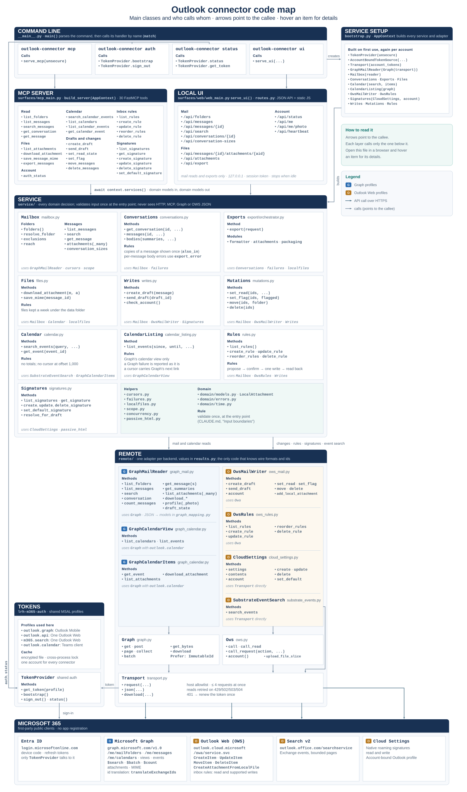

# Outlook Connector — Architecture

**Inputs:** [Requirements v4](requirements.md) · [Roadmap](roadmap.md) · [API research](api-research.md)

The code map shows every class and who calls whom; open it in a browser to see the tooltips. This document records only the rules the code and the diagram cannot show. *What* the connector must do is in the requirements; *why* each API was chosen, with its evidence, is in the research. Each fact is stated once, in the file whose scope it is, and linked from elsewhere.

---

## 1. Principles

1. **Remote first.** Outlook's servers list, filter, search and group conversations. The app keeps locally only what the server cannot give back.
2. **No always-on service.** Every entry point is a short-lived local process for one user (§2).
3. **One domain implementation, thin surfaces.** The UI and MCP call the same service; neither reimplements domain decisions.
4. **Protocol knowledge stays at the edge.** Only [`remote/`](../src/outlook_connector/remote/) knows URLs, Graph/OWS JSON, id formats and paging.
5. **Documented first, gaps filled.** Prefer documented Graph where the granted profile supports it, and Outlook-specific services for the rest. The split follows tenant grants and is swappable (§6).
6. **Current format only.** No migrations or compatibility shims ([AGENTS.md](../AGENTS.md)). Development databases are reset, not migrated.

## 2. Process model

| Command | Lifetime | Loads |
|---|---|---|
| `outlook-connector mcp` | One stdio process per MCP client session | core + MCP |
| `outlook-connector ui [--port]` | Localhost web server; exits on Ctrl+C or after 30 idle minutes | core + web stack |
| `outlook-connector auth [--sign-out] [--unsecure]` | Prepares every shared profile, or signs out | shared auth |
| `outlook-connector status [--check]` | Offline profile and cache status, shaped like `auth_status`; `--check` acquires tokens but does not prove API authorization | shared auth |

- **No in-memory state outlives a call.** Cursors are self-contained (remote link, offsets and the original options) and survive a client restart.
- **Caches are used only while fresh.** Each process keeps the folder list in memory while it is younger than 10 minutes; an older one waits for a refresh. Messages are always listed from the server.
- **No background work.** The UI's idle timer only stops the process. Exports run inside the request or tool call that asked, with no job queue.
- **Concurrency is cross-process.** Outlook, Teams and SharePoint processes may run at once: the shared MSAL cache locks across processes and invalidates by account generation, and output files use exclusive creation. Nothing else is shared between processes.
- **Startup is cheap.** Nothing runs before the first call; only `ui` imports the web stack; only `auth` signs in interactively.

## 3. Layers

Surfaces → service → remote, as in the diagram:

- [`surfaces/`](../src/outlook_connector/surfaces/) import [`service`](../src/outlook_connector/service/) and [`domain`](../src/outlook_connector/domain/) only.
- [`service`](../src/outlook_connector/service/) imports the adapters, the values they return ([`remote/results.py`](../src/outlook_connector/remote/results.py)) and [`domain`](../src/outlook_connector/domain/); it never sees Graph or OWS JSON. [`bootstrap.py`](../src/outlook_connector/bootstrap.py) builds the adapters and passes them in.
- [`remote`](../src/outlook_connector/remote/) returns domain models; each `*_mapping.py` module is the only place that knows its wire fields. Unknown fields are ignored; missing optional fields become None.
- [`domain`](../src/outlook_connector/domain/) imports nothing from the app.

## 4. Repository layout

Tests and the synthetic mailbox ([`tests/fakes/graph_fake.py`](../tests/fakes/graph_fake.py)) are under [`tests/`](../tests/). The research probes under [`research/`](../research/) are separate and stdlib-only.

## 5. Module responsibilities

Only rules the code layout does not make obvious. Per-tool behavior is §8; wire shapes are in the research.

### 5.1 Shared authentication (`lrh-m365-auth`)

- One encrypted, cross-process-safe MSAL cache and the named profiles (§7 has the paths). `--unsecure` selects a separate plaintext development cache with a warning.
- Only `auth` signs in, asking only for profiles that need approval; other calls report the `outlook-connector auth` command.
- An account-generation marker makes running processes drop memoized tokens after sign-out or an account switch. The composition root derives the account from `outlook.graph` and rebuilds the services when it changes (§7).
- A cached profile does not prove an operation is authorized. Refused client/scope pairs stay out of the profile catalog.

### 5.2 [`remote/transport.py`](../src/outlook_connector/remote/transport.py)

- One `httpx.AsyncClient` per process. [`remote/urls.py`](../src/outlook_connector/remote/urls.py) is the only outbound URL policy: an HTTPS host allowlist, Graph continuation links kept under the versioned Graph root, no redirects. Responses are size-capped; downloads stream.
- One auth/retry state machine. Idempotent requests (GETs and read-style POSTs such as a `$batch` of GETs) retry on 429 and honor Retry-After. A write is retried, bounded and honoring Retry-After, only when the failure proves nothing was applied: the connection never opened, or Microsoft answered 429 or 503. No answer or any other 5xx raises `WriteOutcomeUnknown` and is never resent.
- At most 4 requests in flight per process (Exchange allows about 4 concurrent requests per app and mailbox, and 10,000 per 10 minutes).
- 401 renews the token once (force refresh, or the claims challenge from `WWW-Authenticate`), then raises `AuthenticationRequired`. 403 raises `PermissionDenied`, a kind of `Upstream`: access denied for that item, never a sign-in problem.
- Errors name the operation in progress ("While fetching message bodies"), the HTTP status, the service code, a shortened message and the request id.

### 5.3 [`remote/ids.py`](../src/outlook_connector/remote/ids.py)

The only id converter: a Graph immutable id becomes an OWS ItemId by swapping the base64 alphabet (`-`→`/`, `_`→`+`), and conversation ids likewise (research §4.2). The synthetic mailbox uses the same helpers.

### 5.4 Graph: [`graph.py`](../src/outlook_connector/remote/graph.py), [`graph_mail.py`](../src/outlook_connector/remote/graph_mail.py), [`graph_calendar.py`](../src/outlook_connector/remote/graph_calendar.py)

- Every call sends `Prefer: IdType="ImmutableId"`. Paging stops at a repeated link.
- **`$batch`** holds up to 20 sub-requests with numeric request ids mapped back (Graph compares ids case-insensitively, and immutable ids can differ only by case). At most 2 batches are in flight per process; items answered 429/502/503/504 are re-sent in new batches after Retry-After, for up to 4 rounds. Results stay per item.
- `list_folders` includes hidden folders, because the service needs them to decide what is out of reach.
- `$search` returns regular ids; one `translateExchangeIds` call per page converts them (on failure the page keeps its search ids).
- Message text is Graph's `body` or `uniqueBody` with `Prefer: outlook.body-content-type="text"`, passed through unchanged. `draft_state` reads status, version, folder and the stored size (`Integer 0x0E08`); Graph messages have no top-level `size`.
- Attachments are always listed, whatever `hasAttachments` says.
- **Calendar.** [`graph_calendar.py`](../src/outlook_connector/remote/graph_calendar.py) uses `config.CALENDAR_PROFILE` (`outlook.calendar`, on the Teams client; the Outlook Graph profile has no calendar scope), asks for UTC and text bodies, refuses non-UTC times, and converts ids to the Outlook Web form. A cursor carries Graph's next link and is accepted only for the same view, window and page size; for a selected calendar, either path form Graph uses (`/calendars/{id}` or `/calendars('{id}')`) names it (research §3.8).

### 5.5 Outlook Web: [`ows.py`](../src/outlook_connector/remote/ows.py), [`ows_mail.py`](../src/outlook_connector/remote/ows_mail.py), [`ows_mapping.py`](../src/outlook_connector/remote/ows_mapping.py), [`substrate_events.py`](../src/outlook_connector/remote/substrate_events.py)

- Bearer-only envelope (research §4.1–4.2): payloads up to 2,048 characters go in `X-OWA-UrlPostData`; the anchor mailbox is the Outlook token's upn.
- Two request styles. `Ows.call` sends one item action in the JsonRequest envelope; an item whose ResponseClass is not Success or Warning raises with its ResponseCode. `Ows.call_request` sends inbox-rule actions as the bare request object (research §4.4): `WasSuccessful`/`ErrorCode` decide, and an answer without them is an unknown outcome. `call_read` is the retryable read path.
- Writes: drafts are `CreateItem` (SaveOnly); replies are `ReplyToItem`/`ReplyAllToItem` with explicit recipients and an HTML body, so the quoted original keeps its formatting. Local files upload after save through `CreateAttachmentFromLocalFile` in raw 14 MiB slices (research §4.6). `send_draft` is `UpdateItem` with SendAndSaveCopy, no field changes and the change key the draft was read at (NeverOverwrite); `SendItem` is not supported over OWS. Read state and flags are one `SetItemField` per message with read receipts suppressed, and conversations are done per message, not with ApplyConversationAction. `DeleteItem` uses MoveToDeletedItems only.
- **Calendar search** calls Outlook-hosted Search v2 (`m365.search`) and keeps `Cvid` and `LogicalId` across one walk's pages (research §6.1).

### 5.6 [`remote/cloud_settings.py`](../src/outlook_connector/remote/cloud_settings.py)

- Native signatures over Outlook Cloud Settings, with no local copy. Reads fetch the name list and both defaults fresh; each content read checks its scope against the list. Missing records mean no names or defaults; malformed or duplicate records and mismatched scopes fail.
- The opaque account scope is carried from present settings into writes, so with none, configure a signature in Outlook first. Names are URL-encoded for content reads, and commas are refused because the list is comma-joined.

### 5.7 [`domain/`](../src/outlook_connector/domain/)

- Pydantic models are the only schema: FastMCP derives tool schemas from them and the web API serializes them. Output models leave out unset optional fields, so a missing field means its default.
- A message has one `received_at` (receive time, falling back to send time). A time without a zone is UTC ([`domain/time.py`](../src/outlook_connector/domain/time.py)).
- `Failure` (status, code, shortened message, request id) is the per-item failure value; `ExportError` adds the likely cause, retry and fix.
- Domain errors are the same in every `lrh-*` connector: `InvalidRequest` (with `DownloadLimitExceeded`), `NotFound`, `Throttled`, `Upstream` (with `PermissionDenied`), `WriteOutcomeUnknown`, and `AuthenticationRequired` and `AccountMismatch` from the shared sign-in.

### 5.8 Local state

There is no local database (decided 2026-11-03). Each process keeps its folder list in memory (§5.9), and the data directory holds only downloads, exports and logs (§7). No message data is kept (research §3.2).

### 5.9 [`service/`](../src/outlook_connector/service/)

- Input is validated and normalized once, at service entry points, for every surface.
- Concurrent reads run in groups of four; a failure cancels and awaits the siblings before returning the original error.

**[`mailbox.py`](../src/outlook_connector/service/mailbox.py)**
- The folder map is reused while younger than 10 minutes, whichever process saved it; otherwise the call waits for one refresh per process, shared by concurrent lookups.
- **Scope categories** (contract in §8.1) are derived once per folder map from each folder and its parents, in precedence hidden (also Sync Issues, recognized by its well-known alias) > deleted_or_junk > outgoing. A folder deleted in Outlook sits in Deleted Items, so it counts as deleted. Meeting mail is filtered per message.
- An unknown folder id refreshes the folder list once; ids still unknown are treated as outside the mail folders. Of several copies, a received copy is kept.
- **Mailbox-wide listing** picks a method on each first page. When the folders the scope leaves out hold at least two thirds of the mailbox (`PER_FOLDER_SHARE`, from cached counts), it lists folder by folder: one `$count` batch picks in-scope folders with mail in the window, each eligible folder gets a head read sized by its share, and the newest `limit` win. The same batch counts the window's Deleted Items and Junk. Otherwise it lists `/me/messages` and filters after paging, skipping a bounded number of empty pages. Both give the same messages in the same order; the cursor keeps the method.
- Search asks KQL for a day more on each side (KQL takes dates only), then filters to the exact window.

**[`failures.py`](../src/outlook_connector/service/failures.py)** is the one classification of failed Microsoft requests (table in requirements §11) and the one renderer of the `[EXPORT ERROR]` block and the "Export errors" line.

**[`writes.py`](../src/outlook_connector/service/writes.py)**
- HTML bodies and signatures pass one checker, [`passive_html.py`](../src/outlook_connector/service/passive_html.py) (rules in §8.10). Text bodies become escaped minimal HTML that keeps whitespace.
- Each local file gets a narrow draft-state read for the current version; final read-back fetches text with attachment metadata once and HTML once, so N files cost N + 3 Graph requests before signature or reply-history checks. Failed files are carried as structured results; error strings are presentation only.
- An ambiguous send reads the exact id: a Sent Items copy proves it was sent, otherwise the result is `unknown`.

**[`rules.py`](../src/outlook_connector/service/rules.py)** with [`ows_rules.py`](../src/outlook_connector/remote/ows_rules.py)
- OWS reports neutral "not set" values on every rule (`NullImportance`, `NullSensitivity`, `NullInboxRuleMessageFlag`, `NullInboxRuleMessageType`, description metadata); they do not make a rule unsupported.
- A proposal's code binds the account, the normalized request and every rule's revision (unsupported rules by hash). Confirmation re-reads the rules, refuses a changed proposal, sends one write and reads back. There is no rule cache or proposal registry.
- `NewInboxRule` can report an identity a fresh read does not, so a create takes the id of the one new matching rule from read-back. Rules address folders by name, so duplicated names cannot prove exact identity.

**[`mutations.py`](../src/outlook_connector/service/mutations.py)** reads explicit ids in one `$batch` first: unknown → `not_found`, outside the mail folders → `failed`, already as wanted → `unchanged` with nothing sent. The rest go in chunks of 20; on `WriteOutcomeUnknown` the chunk is read back, `done` where the change is visible and `unknown` elsewhere.

**[`markers.py`](../src/outlook_connector/service/markers.py)** names attachments and renders their markers (§8.6) for reads and exports alike.

**[`export/`](../src/outlook_connector/service/export/)**
- [`orchestrator.py`](../src/outlook_connector/service/export/orchestrator.py): copies merge in one final pass, and the window pages with `skip_returned_copies=False`, so `also_in` names every folder. Explicit ids are read first and fail the export before anything is written. Bodies fetched while selecting are reused.
- [`formatter.py`](../src/outlook_connector/service/export/formatter.py): people are separated by `; ` because display names are often "Last, First".
- [`packaging.py`](../src/outlook_connector/service/export/packaging.py): files are created exclusively, with a numbered suffix on a clash.

### 5.10 [`surfaces/`](../src/outlook_connector/surfaces/)

- **MCP** ([`mcp_main.py`](../src/outlook_connector/surfaces/mcp_main.py)): FastMCP over stdio. Tools pass values to the service unchanged and return files as local paths, never inline base64. The server instructions and tool descriptions are what agents read, so they restate the rules agents need; they are the one deliberate duplicate of §8.
- **Web** ([`surfaces/web/`](../src/outlook_connector/surfaces/web/)): a Starlette JSON API over the same service calls, bound to 127.0.0.1, with a per-run session token and a localhost Host check on every call. It serves the read operations plus downloads, conversation sizes, exports, status, profile and a heartbeat that keeps the idle timer alive; writes are MCP-only. GET requests take scope as `sent_items`, `meeting_mail` and `deleted_items` query parameters; JSON requests use a nested `scope`. `POST /api/export` returns one download with an `X-Export-Errors` header. The UI is described in the README and shown in [`ui-preview.svg`](ui-preview.svg).

### 5.11 Local UI design rules

Shared by the Outlook and Teams connector UIs; each keeps its own accent color, layout and vocabulary.

- **Type and shape:** `"Segoe UI", system-ui, sans-serif`; corners of about 4 px on fields and buttons, 8–12 px on cards, menus and dialogs; round avatars and icon buttons.
- **Header:** the product name, then search or filters, with the signed-in account at the far right.
- **Settings:** download options sit behind a cog beside the filters, as switches (`role="switch"`) or a segmented choice; the menu stays open while they change and closes on an outside click or Escape.
- **Footer:** the selection on the left (a count or pills, with **Clear all**), status and actions on the right, the primary action last. Buttons never wrap.
- **Date range:** weeks start on Sunday, future days are disabled, two clicks in either order make the range, and × clears it.
- **States:** one spinner per loading area; empty, loading, ready and failed are distinct, and a failure offers Retry. Message content is rendered as text, never HTML.
- **Theme:** light and dark follow the system setting, live.

Outlook still has rounder corners than this rule on its search fields, folder buttons, icon buttons, segmented control, message rows and app frame; it has not been restyled.

## 6. Capability routing and portability

The routing reflects the tenant's grants (research §2), not a fixed split between reads and writes; the Outlook profile is therefore needed by some read-only tools too.

| Capability | Adapter | Token profile |
|---|---|---|
| Folders, messages, conversations, search, attachments, MIME, profile and photo; read-after-write checks | [GraphMailReader](../src/outlook_connector/remote/graph_mail.py) | `outlook.graph` |
| Exchange event search | [SubstrateEventSearch](../src/outlook_connector/remote/substrate_events.py) | `m365.search` |
| Event hydration, attachment metadata and bytes | [GraphCalendarItems](../src/outlook_connector/remote/graph_calendar.py) | `outlook.calendar` |
| Calendar catalog and events in a window | [GraphCalendarView](../src/outlook_connector/remote/graph_calendar.py) | `outlook.calendar` |
| Drafts and send; read state, flags, move and soft delete | [OwsMailWriter](../src/outlook_connector/remote/ows_mail.py) | `outlook.api` |
| Inbox rules | [OwsRules](../src/outlook_connector/remote/ows_rules.py) | `outlook.api` |
| Native signature settings and contents | [CloudSettings](../src/outlook_connector/remote/cloud_settings.py) | `outlook.api` |

### 6.1 Changing a backend

Each capability has one adapter, and services take it directly; there are no interfaces with a single implementation (decided 2026-11-03). [`bootstrap.py`](../src/outlook_connector/bootstrap.py) builds the adapters, and each requests its named profile. To move a capability to another backend, write an adapter with the same methods and returned values, then change `bootstrap.py` and the service's type hints. Add an interface only when two adapters exist at once. A write uses one backend and is never retried through another; no read falls back to another backend.

### 6.2 Routes not used

- **Browser-token tools** ([outlook-cli](https://github.com/yusufaltunbicak/outlook-cli), [owa-piggy](https://github.com/damsleth/owa-piggy)) show useful route names but borrow the browser's sign-in; the connector uses its own tokens.
- **`GetAccessTokenForResource` over OWS** is a historical token-minting path ([Black Hat 2019](https://i.blackhat.com/USA-19/Thursday/us-19-Jaiswal-Preventing-Authentication-Bypass-A-Tale-Of-Two-Researchers.pdf)).
- Outlook REST v2 and EWS are retired or retiring.
- `ab0455a0-8d03-46b9-b18b-df2f57b9e44c`, seen in Outlook Web's consumer-auth configuration, is unverified. The Exchange app id `00000002-0000-0ff1-ce00-000000000000` is a resource, not a client.

### 6.3 Adapting to another tenant or a policy change

Re-run the relevant probes from [research/README.md](../research/README.md), record the result in the research log, and change the configured profiles and adapters. The domain, service, store and surfaces stay unchanged.

## 7. Data and identity

- **Account fingerprint:** a hash of tid + oid. Rule proposals are bound to it, and a change of it rebuilds the services.
- **Keys:** a message is its Graph immutable id, which survives moves within the mailbox; a conversation is Graph's conversationId.
- **Data directory:** `%USERPROFILE%/.lrh-outlook-connector` on Windows, `$XDG_DATA_HOME/lrh-outlook-connector` (or `~/.local/share/...`) elsewhere; `OUTLOOK_CONNECTOR_HOME` overrides it.
  - Exports: `exports/`. Downloads: `downloads/<source>/<name>`, one folder per message attachment (a hash of the two ids), and saved `.eml` files in `downloads/`. Both are removed after 7 days, one process per folder at a time, tolerating files another process removed first. An export's attachment downloads use an OS temp directory.
  - Logs: `logs/<command>-<start time>-<process id>.log`, one per `mcp` or `ui` process, rotated at midnight and kept 7 days. The MCP server logs to its file only, since stdout carries the protocol. [`logs.py`](../src/outlook_connector/logs.py) is the same module in every `lrh-*` connector: it redacts bearer tokens, credential headers, assigned secrets and secret query parameters, and holds `httpx` and `httpcore` (which log full URLs) at WARNING. `OUTLOOK_CONNECTOR_LOG_LEVEL` sets the level (default INFO).
- **Token cache:** `~/.lrh-m365-auth/token-cache.bin` (`%USERPROFILE%` on Windows); `M365_AUTH_HOME` overrides it.

## 8. Surfaces: tools and endpoints

The MCP server exposes 30 tools; the [README](../README.md#mcp-tools) lists them. Parameters, ranges and defaults are in each tool's schema and description in [`mcp_main.py`](../src/outlook_connector/surfaces/mcp_main.py). This section records the behavior and caveats behind them. The backend for each capability is in §6.

### 8.1 Shared rules

- **Reads never change the mailbox**, not even read state. Tools that save files write only to the data directory (§7), kept seven days.
- **Writes are explicit**, each a separate tool. No tool permanently deletes mail.
- **Scope.** One `scope` object holds three independent keys: `sent_items` (default true) includes Sent Items, Drafts and Outbox; `meeting_mail` (default true) includes invitations, RSVPs and cancellations; `deleted_items` (default false) includes Deleted Items and Junk Email. A folder you name is always included, and subfolders count with their parent. A key an operation cannot apply is refused when it differs from its default.
  - Conversations use `ConversationScope`, whose `deleted_items` defaults to true; empty and partial objects keep that default, and only an explicit false leaves deleted mail out. This applies to `get_conversation`, conversation sizes, search hits' `message_count` and an export's conversation selections (which keep false only when the request gives it). Conversation reads keep sent and meeting mail. (Built 2026-11-02.)
- **Out of reach.** Hidden folders, Sync Issues and items outside the mail folders (such as Teams meeting records) are never listed, searched, counted, grouped into conversations or selected by folder, window or conversation; `coverage.excluded.hidden` counts what was dropped. Explicit ids are the exception: `get_message`, `export_messages` and the change tools act on them wherever Graph can, though the change tools refuse items outside the mail folders (decided 2026-10-13).
- **Copies and coverage.** A message stored in several folders is shown once, with `also_in` naming the others. `coverage` reports `complete`, `excluded` (counts by reason) and `notes`; follow `cursor` while `complete` is false.
- **Per-message results.** Change tools take explicit ids, at most 100 per call, and return `done`, `unchanged` (nothing sent), `not_found`, `failed` (with Outlook's code) or `unknown` (check before repeating). With `continue_on_error=false`, a failing chunk stops the later ones, reported as `failed` with "not sent".
- **Throttling.** About four concurrent requests and 10,000 per ten minutes, per app and mailbox. Do not call tools in parallel; prefer one large export over many small ones; after a throttling error wait at least a minute.
- **Sign-in.** Tools never sign in. On "sign-in required", run `outlook-connector auth`; one run can show up to three device codes in turn, and an agent running it relays each and waits until every profile is Ready. "Access denied" concerns one item, not the sign-in.

**Limits** enforced by the service (ranges, then the default):

| Tool | Limits |
|---|---|
| `list_messages` | `limit` 1–200, 25 |
| `search_messages` | `limit` 1–100, 25 |
| `get_message` | `max_chars` 1–200,000, 20,000 per piece |
| `get_conversation` | `max_chars` 1–400,000, 40,000 per response |
| `export_messages` | `limit` 1–2,000, 2,000; a larger selection is refused with its count |
| `list_calendar_events` | window at most 366 days; `limit` 1–200, 50; `contains` 1–20 terms of up to 200 characters |
| `search_calendar_events` | query up to 512 characters; `limit` 1–25, 25 |
| `create_draft` | body up to 100,000 characters; up to 100 distinct addresses across `to`, `cc` and `bcc`; a new message needs a subject of up to 255 characters; local files up to 35 MiB together |
| Change tools | up to 100 message ids |
| Downloads and MIME saves | 150 MiB per file |

### 8.2 Sign-in and status

`auth_status` is built by the shared library's `status_report`, the same function every connector and `status` use. A cached token shows that sign-in state exists, not that an operation is allowed.

### 8.3 Folders and message listing

- `list_folders` reads at most 1,000 folders per level of the tree and does not report a cut level.
- `list_messages`: exclusions can leave a page short, so follow `cursor`. The folder-by-folder method (§5.9) gives full but slower pages, and `coverage.notes` says so. `server_total` counts copies separately and includes meeting mail that `meeting_mail=false` hides.

### 8.4 Searching mail

`search_messages` uses Graph `$search`, groups hits by conversation in rank order, and searches mail only. `message_count_at_least` is set when a conversation is larger than one server listing.

### 8.5 Reading mail

- `get_message` reads an id in a hidden folder when Graph allows it. `NotFound` does not guess the cause: deleted, moved out of reach or a wrong id.
- `body="html"` is Graph's cleaned view: scripts, event handlers and other active content that the stored message keeps are removed ([research §4.5](api-research.md#45-what-outlook-keeps-of-saved-html)). `save_message_mime` returns the original.
- `get_conversation` lists every message, sorted oldest first locally; `max_chars` bounds one response's bodies and `cursor` continues at the next message with the original options. A body that cannot be fetched sets `export_error` and shows an `[EXPORT ERROR]` block; `coverage.complete` stays false while a retry might succeed.

### 8.6 Attachments and saved files

Full and unique text is Exchange's own conversion, returned unchanged with its `[cid:…]` and `[alt text]` placeholders ([research §3.6](api-research.md#html-to-text-body)). After the body, attachments follow as `[Image: name]`, `[File: name]`, `[Message: name.eml]` and `[Link: name]`. Names come from attachment metadata, made safe and unique within the message (`report.pdf`, `report (2).pdf`); text, CIDs and HTML are never used to infer an image's position or identity.

- `download_attachment` takes exactly one of `message_id` or `event_id`; event files are listed and downloaded under `outlook.calendar`, without reading the event. An unknown name is refused before any download, listing the names there are. Each file is fetched once into the download cache and published only when complete. Cloud links are listed under `unavailable`; a call that saves nothing fails. Forwarded messages save as `.eml`, best effort.
- Downloads and MIME saves over 150 MiB are refused; download those from Outlook.

### 8.7 Exports

- The output is one `.txt` or `.jsonl`, or a `.zip` when there are several files or attachments, with text files at the root and each one's attachments in a folder named for it.
- Explicit message ids are authoritative, hidden folders included. If any cannot be read, the export fails before writing: `NotFound`, `Throttled` after retries, or `Upstream`, with the count and first ids.
- Body and attachment gaps do not stop the export: TXT marks them `[EXPORT ERROR]`, JSONL carries `export_error` and `body: null`.
- With attachments on, every listed file is included, inline files and forwarded messages too; cloud links are listed only. Text names each file by its final stored name. JSONL without file bytes still carries every attachment's metadata. Identical files are stored once per output file.

### 8.8 Calendar listing

- `list_calendar_events` returns events overlapping the window (at most 366 days), occurrences expanded. `contains` terms are literal phrases, case- and accent-insensitive, matched in the subject or the description separately; any term matches. Descriptions are cut to 4,000 characters, marked by `body_truncated`.
- One call reads at most ten Graph pages of up to 100 events; when it stops there before `limit` matches, `coverage.notes` says so. A failed Graph read is reported as that error, with no other backend answering.
- `list_calendars` returns `id`, `name` and `is_default`. Shared and delegated calendars are in live verification (roadmap).

### 8.9 Calendar search and event details

Outlook owns the event, its schedule, invitees and join link; `lrh-teams-connector` owns the meeting chat, recordings, transcripts, recaps and notes. No event is mapped to Teams resources automatically.

- `search_calendar_events` (Search v2) takes no date bounds: query terms did not restrict dates, and filtering after paging could miss events past 1,000 results; use `list_calendar_events` for a range. No cursor is issued at offset 1,000, which Search v2 refuses, and recurring totals are not reported because they were inconsistent (research [§6.1](api-research.md#61-request-and-paging)). Hits without an Outlook item id cannot be hydrated, and `notes` says so.
- `get_calendar_event` reads `GET /me/events/{id}` (research [§3.8](api-research.md#38-calendar-through-the-teams-client-graph-profile)). `teams_chat_id_from_join_link` comes from the `19:meeting_…@thread.v2` segment of `onlineMeeting.joinUrl` only, an undocumented format, so agents check the chat in Teams when details look odd. Graph has no `display_to` or truncation flag, so those stay unset. More than 500 attachments, or one without an id, is an error.

### 8.10 Drafts and sending

- Drafts are composed once and never edited. To change one, create a full replacement (same `reply_to_message_id` and `reply_all`, every intended file listed), check its read-back, then delete the old draft. Never delete first. Outlook edits and attachments to the old draft are not carried over.
- **Passive HTML.** Outlook stores and sends active content unchanged, so this check is the only protection; in testing, recipients' clients still submitted forms ([research §4.5](api-research.md#45-what-outlook-keeps-of-saved-html)). Refused: declarations, scripts, frames, form controls, event-handler attributes, `javascript:` and `vbscript:` URLs, `base`, elements that change how the rest is read (`plaintext`, `title`, `xmp`, `noembed`, `noframes`, `noscript`) and markup left open at the end, so the appended signature can neither complete the body's markup nor render as text.
- **Signatures** are resolved fresh for each draft; a missing or unreadable selected signature is an error, not a fallback, and a text-only one is escaped.
- **Replies** report `history_intact` and `history_problem`: whether the quoted original kept its full text, its structure (lists, tables, emphasis, links, image references) and its inline images.
- **Local files** are checked before `CreateItem`; files totaling over 35 MiB are refused there. After the uploads, Graph must list each file by name at its size or up to 64 KiB more (Graph adds a small overhead; research §4.6). A failed upload or confirmation moves the draft to Deleted Items and names the file.
- **`send_draft`** takes only an id. It refuses a stored size over 35 MiB, Outlook's send limit (research §4.6), and sends a draft whose size Graph does not report, since Outlook still bounces an oversized one. A draft changed since it was read is refused and nothing is sent. `unknown` means check Sent Items and Outbox before any other send.

### 8.11 Mailbox changes

None is read-only by annotation, so clients ask before each call; move and delete are also marked destructive.

- `set_read_state` expands conversations to every message in scope, copies included; only `scope.deleted_items` applies. With over 100 messages, `counts` covers all, and `results` keeps explicit ids and anything not `done` or `unchanged`. Read receipts are never sent.
- `set_flag` does not expand conversations.
- `move_messages` refuses Deleted Items (use `delete_messages`) and hidden folders.
- `delete_messages` moves to Deleted Items and leaves messages already there, or in its subfolders, alone.

### 8.12 Native signatures

Names are exact, case-sensitive and comma-free. Embedded images must be `data:image/...` URIs in a quoted `src` attribute with no whitespace, and are attached inline when a draft uses the signature. Outlook may keep a deleted name as a default, so set a valid default afterwards. To rename, create, delete the old one and reset its defaults. To copy a signature from a draft, replace each `cid:` reference with a `data:image` URI of that image's bytes.

### 8.13 Inbox rules

Supported rules have sender, recipient, subject or subject-or-body conditions, a move-to-folder action and stop-processing. Anything else, such as an exception, makes a rule unsupported and read-only; reordering is refused while one exists.

Every change follows one flow: the call without `user_confirmation` returns `status: proposed`, the exact change and a `confirmation` code bound to the current rules. Show the person that change, and repeat the call with the code only after they approve. The change is then sent once and read back: `done`, `failed` or `unknown` (check Outlook before repeating). A code from changed rules is refused. Turning a rule on or off must be the only field in its update; `reorder_rules` lists every supported rule.

## 9. Cross-cutting concerns

| Concern | Rule |
|---|---|
| Logging | Operation, status, counts, durations, backend. Never subjects, bodies, addresses, query text, tokens, cookies or ids in clear (logged URL paths show `{id}`). |
| Retries | As §5.2: reads retry, bounded and honoring Retry-After; a write is resent only when it provably was not applied; an ambiguous write is read back, never resent. |
| Bounds | Every list, search, conversation and body response is size-bounded with a cursor. Binary content goes through files. |
| Errors | Domain errors from the service (§5.7). The MCP surface returns tool errors; the web surface returns HTTP status and JSON, with 403 for access denied. Bulk operations report per-item gaps instead of failing whole. |
| Security | Localhost-only web binding, outbound host allowlist, no arbitrary URL fetching, no browser credentials. UI responses send `nosniff` and `no-referrer`. |
