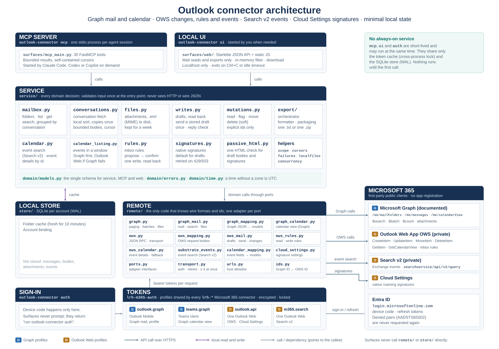

# Outlook Connector — Architecture

**Inputs:** [Requirements v4](requirements.md) · [Roadmap](roadmap.md) · [API research](api-research.md)

The classes and who calls whom, in more detail: [code map](diagrams/code-map.svg). The diagrams give the overview; this document records the rules and contracts the code and diagrams cannot show. *What* the connector must do is in the requirements; *why* each API was chosen is in the research.

---

## 1. Principles

1. **Remote first.** Outlook's servers do the work: listing, filtering, search, conversation grouping. The app keeps locally only what the server cannot give back.
2. **No always-on service.** Every entry point is a short-lived local process started on demand, for one user (§2).
3. **One domain implementation, thin surfaces.** The UI and MCP call the same service. Neither reimplements domain decisions.
4. **Protocol knowledge stays at the edge.** Only [`remote/`](../src/outlook_connector/remote/) knows URLs, Graph/OWS JSON, id formats and paging.
5. **Documented first, gaps filled.** Prefer documented Graph where the granted profile supports it; use Outlook-specific services for the rest. The split depends on tenant grants and is swappable (§6).
6. **Small modules.** Each responsibility gets its own module from the start.
7. **Current format only.** No migrations or compatibility shims ([AGENTS.md](../AGENTS.md)). Development databases are reset, not migrated.

## 2. Process model

There is no daemon. MCP and the UI run only for their active client or session; `auth` and `status` are one-shot commands.

| Command | Lifetime | Loads |
|---|---|---|
| `outlook-connector mcp` | One stdio process per MCP client session | core + MCP |
| `outlook-connector ui [--port]` | Localhost web server; exits on Ctrl+C or after an idle timeout | core + web stack |
| `outlook-connector auth [--sign-out] [--unsecure]` | Prepares every shared profile, or signs out | shared auth |
| `outlook-connector status [--check] [--json]` | Offline profile and cache status; `--check` acquires tokens but does not prove API authorization | shared auth |

Consequences of short-lived processes:

- **No in-memory state outlives a call.** Cursors are self-contained (remote link, offset or per-folder positions, plus the original options) and survive a client restart.
- **Local caches are used only while fresh.** The folder cache is used while younger than 10 minutes; an older cache waits for a refresh. Messages are always listed from the server.
- **No background work:** no schedulers, sync loops or warm-up tasks. The UI's idle timer only stops the process.
- **Concurrency is cross-process.** Outlook, Teams and SharePoint processes may run at once: the shared MSAL cache locks across processes and invalidates by account generation; the SQLite store uses WAL, a busy timeout, short transactions and one connection per operation; output files use exclusive creation.
- **Startup is cheap.** Nothing runs before the first call; the web stack is imported only by `ui`. MCP and UI never prompt; only `auth` signs in interactively.
- **Not a hosted service:** one user, localhost only (the UI binds 127.0.0.1 with a per-run session token).
- **Exports run in the process that asked**, inside one request or tool call, with no job queue or progress reporting (§5.9 export).

## 3. Layers

Surfaces → service → remote and store, as in the diagram. The import rules:

- Surfaces ([`surfaces/`](../src/outlook_connector/surfaces/)) import [`service`](../src/outlook_connector/service/) and [`domain`](../src/outlook_connector/domain/) only.
- [`service`](../src/outlook_connector/service/) imports the ports in [`remote/ports.py`](../src/outlook_connector/remote/ports.py) (never a concrete adapter), [`store`](../src/outlook_connector/store/) and [`domain`](../src/outlook_connector/domain/). It never sees Graph or OWS JSON. [`bootstrap.py`](../src/outlook_connector/bootstrap.py) wires the adapters.
- [`remote`](../src/outlook_connector/remote/) returns [`domain`](../src/outlook_connector/domain/) models; each `*_mapping.py` module is the only place that knows its wire fields.
- [`domain`](../src/outlook_connector/domain/) imports nothing from the app.

## 4. Repository layout

The [code map](diagrams/code-map.svg) shows every package and class. Tests and the synthetic mailbox ([`tests/fakes/graph_fake.py`](../tests/fakes/graph_fake.py)) are under [`tests/`](../tests/); the research probes under [`research/`](../research/) are separate and stdlib-only.

## 5. Module responsibilities

Only rules that the code layout does not make obvious are listed here. The per-tool contract is §8.

### 5.1 Shared authentication (`lrh-m365-auth`)

- One encrypted, cross-process-safe MSAL cache (`~/.lrh-m365-auth/token-cache.bin`, or `M365_AUTH_HOME`) and the named profiles. Encryption is mandatory; `--unsecure` selects a separate plaintext development cache with a warning.
- Only `auth` signs in interactively, reusing cached credentials and asking only for profiles that need approval. Other calls report the `outlook-connector auth` command when sign-in is required.
- An account-generation marker makes running processes drop memoized tokens after sign-out or an account switch. The composition root derives the account from `outlook.graph` and rebuilds its services and store when the identity changes; the store's owner fingerprint is checked first (§7).
- Refused client/scope pairs stay excluded from the profile catalog. A cached profile does not prove an operation is authorized.

### 5.2 [`remote/transport.py`](../src/outlook_connector/remote/transport.py)

- One `httpx.AsyncClient` per process. [`remote/urls.py`](../src/outlook_connector/remote/urls.py) is the only outbound URL policy: an HTTPS host allowlist, Graph continuation links kept under the versioned Graph root, no redirects. Responses are size-capped; downloads stream.
- One auth/retry state machine for requests and downloads. Only idempotent requests retry (GETs, and read-style POSTs such as a `$batch` of GETs), honoring 429 and Retry-After. A write is sent once: no answer or a 5xx raises `WriteOutcomeUnknown`; a 4xx or 429 is a definite failure.
- At most **4 requests in flight** per process (Exchange allows about 4 concurrent requests per app and mailbox, and 10,000 per 10 minutes).
- **401** renews the token once (force refresh, or the claims challenge from `WWW-Authenticate`); a second 401 raises `AuthenticationRequired`. **403** is access denied for that item, never a sign-in problem.
- Errors name the operation in progress ("While fetching message bodies"), the HTTP status, the service code, a shortened message and the request id. Logs carry metadata only.

### 5.3 [`remote/ids.py`](../src/outlook_connector/remote/ids.py)

The only id converter: a Graph immutable id becomes an OWS ItemId by swapping the base64 alphabet (`-`→`/`, `_`→`+`); conversation ids likewise (research §4.2). The synthetic mailbox uses the same helpers.

### 5.4 Graph: [`graph.py`](../src/outlook_connector/remote/graph.py), [`graph_mail.py`](../src/outlook_connector/remote/graph_mail.py), [`graph_mapping.py`](../src/outlook_connector/remote/graph_mapping.py)

- Every call sends `Prefer: IdType="ImmutableId"`. Paging follows nextLink on the Graph host and stops at a repeated link.
- **`$batch`**, up to 20 sub-requests: request ids are numbers mapped back (Graph compares ids case-insensitively, and immutable ids can differ only by case); at most 2 batches in flight per process; throttled or temporarily failing items (429/502/503/504) are re-sent in new batches after Retry-After, for up to 4 rounds; results stay per item, so callers report failures per message.
- `list_folders` includes hidden folders: the service needs them to decide what is out of reach.
- Meeting-mail fields (kind, time, place, out of date) come from `eventMessage` properties in the same listing, with no extra requests.
- A conversation listing cannot use `$orderby` with the `conversationId` filter, so the service sorts; Graph pages it, and the connector reads every page (research §3.5).
- `count_messages` returns per-folder counts in one `$batch` (`$count`, `ConsistencyLevel: eventual`); a failed folder is left out instead of hiding the others.
- `$search` returns regular ids; one `translateExchangeIds` call per page converts them to immutable ids (if it fails, the page keeps its search ids).
- Attachments are listed even when `hasAttachments=false`, so inline-only images appear. Downloads stream and retry from scratch like other GETs; the local 150 MB guard stops larger ones.
- [`graph_mapping.py`](../src/outlook_connector/remote/graph_mapping.py) is the only file that knows Graph field names: unknown fields are ignored, missing optional fields become None.

### 5.5 Outlook Web: [`ows.py`](../src/outlook_connector/remote/ows.py), [`ows_mail.py`](../src/outlook_connector/remote/ows_mail.py), [`ows_mapping.py`](../src/outlook_connector/remote/ows_mapping.py), calendar adapters

- Bearer-only envelope (research §4.1–4.2): payloads up to 2,048 characters go in the `X-OWA-UrlPostData` header; the anchor mailbox is the Outlook token's upn.
- Two request styles. `Ows.call` sends one item action in the JsonRequest envelope; an item whose ResponseClass is not Success/Warning raises with its ResponseCode. `Ows.call_request` sends inbox-rule actions as the bare request object (research §4.4); `WasSuccessful`/`ErrorCode` decide success, and an answer without them is an unknown outcome. `call_read` and `call_view` are the retryable read paths (`call_view` for `GetCalendarView`, whose items sit directly in `Body`).
- Writes: drafts are `CreateItem` (SaveOnly), and replies use `ReplyToItem`/`ReplyAllToItem` with explicit recipients and an HTML body so the quoted original keeps its formatting; signature images go in as CID-linked inline attachments. `send_draft` is `UpdateItem` with SendAndSaveCopy and no field changes, bound to the change key the draft was read at (NeverOverwrite); `SendItem` is not supported over OWS. Read state and flags are one `SetItemField` per message with read receipts suppressed; `MoveItem` by distinguished or folder id; `DeleteItem` with MoveToDeletedItems only. Conversation read state is done per message, not with ApplyConversationAction. Writes return an outcome per message and are never retried.
- **Calendar search and details.** [`substrate_events.py`](../src/outlook_connector/remote/substrate_events.py) calls Outlook-hosted Search v2 (`m365.search`, Event/Exchange) and keeps `Cvid` and `LogicalId` across the pages of one walk. [`ows_calendar.py`](../src/outlook_connector/remote/ows_calendar.py) hydrates a result with `GetItem` (default shape plus body and attachment metadata, no attachment bytes). [`service/calendar.py`](../src/outlook_connector/service/calendar.py) keeps agenda text verbatim with its truncation flag, omits Search v2 totals (recurring totals were inconsistent), and issues no cursor at offset 1,000, which Search v2 refuses (research §6.1). Events are never mapped to Teams resources automatically.
- **Calendar windows, Graph first.** [`graph_calendar.py`](../src/outlook_connector/remote/graph_calendar.py) reads `/me/calendarView` under `config.CALENDAR_PROFILE` (`teams.graph`; the Outlook Graph profile has no calendar scope), asks for UTC times and text bodies, refuses non-UTC times, and converts ids to the Outlook Web form for `get_calendar_event`. `OwsCalendarWindow` calls `GetCalendarView` (UTC `TimeZoneContext`, no descriptions). [`service/calendar_listing.py`](../src/outlook_connector/service/calendar_listing.py) falls back to Outlook Web only for a first page whose Graph read failed for a service reason (`AuthenticationRequired`, `Throttled`, `Upstream`), never when `contains` or `include_body` needs descriptions. A cursor keeps the service that answered; Outlook Web pages resume after the last event by (start, id) (research §3.8).

### 5.6 [`remote/cloud_settings.py`](../src/outlook_connector/remote/cloud_settings.py)

- Implements SignatureStore over Outlook Cloud Settings with the account-bound Outlook profile; no local copy.
- Reads fetch the name list and both defaults fresh; each content read checks its scope matches the list. The opaque account scope is carried from present settings into writes. Missing list or default records mean no names or defaults; malformed or duplicate records and mismatched scopes fail. Writes need a scope returned by Outlook, so with none, configure a signature in Outlook first. Each write is one PATCH or DELETE, never retried.
- Names are exact and case-sensitive; commas are refused because the list is comma-joined; names are URL-encoded for content reads.

### 5.7 [`domain/`](../src/outlook_connector/domain/)

- Pydantic models are the only schema: FastMCP derives tool schemas from them, and the web API serializes them. Output models leave out unset optional fields, so MCP results stay small and a missing field means its default.
- A message has one `received_at` (receive time, falling back to send time).
- `Failure` (status, code, shortened message, request id) is the per-item failure value; `ExportError` adds the likely cause, retry and fix for gaps in exports and conversation bodies.
- Errors: `AuthenticationRequired`, `AccountMismatch`, `NotFound`, `InvalidRequest`, `Throttled`, `Upstream`, `WriteOutcomeUnknown`; each surface maps them to its protocol.
- [`domain/time.py`](../src/outlook_connector/domain/time.py): a time without a zone is UTC, an aware time is converted.

### 5.8 [`store/`](../src/outlook_connector/store/)

One SQLite database per account fingerprint: the account binding and the folder cache only. No message data of any kind (research §3.2). A database with another owner is left untouched and a separate one is used.

### 5.9 [`service/`](../src/outlook_connector/service/)

- Input bounds and time windows are validated and normalized once, at service entry points, for every surface.
- Concurrent reads (conversation expansion for exports and read state) run in groups of four; a failure cancels and awaits the siblings before returning the original error.

**[`mailbox.py`](../src/outlook_connector/service/mailbox.py)**
- The folder map is reused while younger than 10 minutes (whichever process saved it); otherwise the call waits for one refresh per process, and concurrent unknown-folder lookups share it.
- **Scope categories** (the contract is §8.1) are derived once per folder map from each folder and its parents, in precedence hidden (also Sync Issues) > deleted_or_junk > outgoing. A folder deleted in Outlook sits in Deleted Items, so it counts as deleted. Meeting mail is filtered per message, so a meeting-only conversation disappears and one with real replies shows through.
- **Out of reach:** hidden folders and items outside the mail folders (e.g. Teams meeting records) drop as `excluded.hidden`. An unknown folder id refreshes the folder list once; ids still unknown are remembered as outside. Sync Issues is recognized by name, since Graph does not always mark it hidden. Of several copies, a received copy is kept.
- **Mailbox-wide listing** picks a method on every first page. When the folders the scope leaves out hold at least two thirds of the mailbox (`PER_FOLDER_SHARE`, from cached counts), it lists **folder by folder**: one `$count` batch picks the in-scope folders with mail in the window, first reads are sized by each folder's share, every eligible folder gets a current head read before the merge, and the newest `limit` win. The same batch counts the window's Deleted Items and Junk, reported on the first page only and only when every excluded folder was counted. Otherwise it lists `/me/messages` and filters after paging, skipping (bounded) pages that filter to nothing. Both give the same messages in the same order; the cursor keeps the method.
- `get_message` with `max_chars=None` returns the whole body in one read (the web reader).
- Search asks KQL for a day more on each side (KQL takes dates only), then filters to the exact `since`/`until`.

**[`conversations.py`](../src/outlook_connector/service/conversations.py)** fetches, sorts oldest first, and hydrates bodies in `$batch`; a body that fails becomes that message's `export_error`.

**[`failures.py`](../src/outlook_connector/service/failures.py)** is the one classification of failed Microsoft requests (the table is in requirements §10) and the one renderer of the `[EXPORT ERROR]` block and the export's "Export errors" line.

**[`writes.py`](../src/outlook_connector/service/writes.py) and [`signatures.py`](../src/outlook_connector/service/signatures.py)**
- Text bodies become escaped minimal HTML that keeps whitespace and NBSP. HTML bodies and signatures pass one checker, [`passive_html.py`](../src/outlook_connector/service/passive_html.py): no active content, no elements that change how the rest is read (`plaintext`, `title`, `xmp`, `noembed`, `noframes`, `noscript`), no markup left open at the end.
- `create_draft` resolves the default or named signature fresh, adds one signature block after the body, turns data-URI images into CID-linked inline attachments, and verifies the saved images and, for replies, the quoted history on Graph read-back. A configuration that changes during the read is refused.
- `send_draft` accepts no content: it checks the bound account and sends the stored draft once. An ambiguous answer reads the exact id; a Sent Items copy proves it was sent, otherwise the result is unknown.

**[`rules.py`](../src/outlook_connector/service/rules.py) with [`remote/ows_rules.py`](../src/outlook_connector/remote/ows_rules.py)**
- A rule with any active unsupported field is read-only. OWS reports neutral "not set" values on every rule (`NullImportance`, `NullSensitivity`, `NullInboxRuleMessageFlag`, `NullInboxRuleMessageType`, and description metadata); those do not count.
- A change first returns a stateless proposal whose code binds the account, the normalized request and every rule's current revision (unsupported rules by hash). Confirmation re-reads the rules and refuses a changed proposal, then sends one OWS write and reads back. A failed read-back or unverified outcome returns `unknown`; a successful write whose read-back differs returns `failed`. No rule cache or proposal registry.
- `NewInboxRule` can report an identity that a fresh read does not, so a create takes the id of the one new matching rule from the read-back. Rules address folders by name; read-back compares names, so duplicated names cannot prove exact identity.

**[`mutations.py`](../src/outlook_connector/service/mutations.py)**
- Ids are checked (at most 100) before anything is read, and the Outlook sign-in must be the bound account.
- Explicit ids are read through Graph in one `$batch`: unknown → `not_found`, outside the mail folders → `failed` (hidden folders are acted on; an explicit id is authoritative), already as wanted → `unchanged` with nothing sent. The rest go in chunks of 20. On `WriteOutcomeUnknown` the chunk is read back: `done` where the change is visible, `unknown` elsewhere.
- Conversations given to `set_read` expand to every message in scope. With more than 100 messages, `counts` covers all and `results` keeps explicit ids and anything not `done` or `unchanged`.
- `move` refuses Deleted Items and hidden folders; `delete` leaves messages already in Deleted Items alone.

**[`files.py`](../src/outlook_connector/service/files.py)** names a saved `.eml` from the downloaded Subject header.

**[`export/`](../src/outlook_connector/service/export/)**
- [`orchestrator.py`](../src/outlook_connector/service/export/orchestrator.py): sources defer copy merging to one final pass, and the window pages with `skip_returned_copies=False`, so `also_in` names every folder. Explicit ids are read first and fail the export before anything is written. Bodies fetched while selecting are reused.
- [`formatter.py`](../src/outlook_connector/service/export/formatter.py): people are separated by `; ` because display names are often "Last, First". JSONL marks a missing body as `body: null` with an `export_error`.
- [`attachments.py`](../src/outlook_connector/service/export/attachments.py): identical files (same bytes) are stored once per output file.
- [`packaging.py`](../src/outlook_connector/service/export/packaging.py): files are created exclusively, with a numbered suffix on a name clash, so concurrent exports never overwrite each other.

### 5.10 [`surfaces/`](../src/outlook_connector/surfaces/)

- **MCP** ([`mcp_main.py`](../src/outlook_connector/surfaces/mcp_main.py)): FastMCP over stdio. FastMCP checks argument types; tools pass values to the service unchanged. Files are returned as local paths, never inline base64. The server instructions carry the usage rules agents need (scope, out of reach, copies, coverage and cursors, throttling, the 150 MB limit, access denied versus sign-in).
- **Web** ([`surfaces/web/`](../src/outlook_connector/surfaces/web/)): a Starlette JSON API over the same service calls, bound to localhost, with a per-run session token and a localhost Host check on every call. `POST /api/export` returns one download with an `X-Export-Errors` header carrying the export's error line; `POST /api/heartbeat` keeps the idle timer alive while a tab is open. Port and idle defaults are in [`ui_settings.py`](../src/outlook_connector/surfaces/ui_settings.py). The UI is described in the README and shown in [`ui-preview.svg`](ui-preview.svg). Its export options (attachments, quoted history and how files are grouped) sit in a settings menu behind the cog, as in the Teams connector; the menu stays open while they change and closes on an outside click or Escape. Details worth knowing: attachment names come from one batched request per 200 messages, conversation sizes are requested after a list loads, a reader answer for a message no longer selected is ignored, and the profile and photo are read once per process.

## 6. Capability routing and portability

Graph handles mail-data reads and read-after-write checks; OWS handles mail changes, inbox rules, event details and the calendar fallback; Cloud Settings handles signatures; Search v2 finds events. The Outlook profile is therefore needed by some read-only tools too. This routing reflects the tenant's grants (research §2), not a fixed split between reads and writes.

| Capability | Port | Adapter | Token profile |
|---|---|---|---|
| Folders, messages, conversations, search, attachment metadata and bytes, MIME, profile and photo; read-after-write checks | MailReader | [GraphMailReader](../src/outlook_connector/remote/graph_mail.py) | `outlook.graph` |
| Exchange event search | CalendarSearchReader | [SubstrateEventSearch](../src/outlook_connector/remote/substrate_events.py) | `m365.search` |
| Selected event hydration and attachment metadata | CalendarItemReader | [OwsCalendarItems](../src/outlook_connector/remote/ows_calendar.py) | `outlook.api` |
| Calendar events in a window, Graph first (`/me/calendarView`) | CalendarViewReader | [GraphCalendarView](../src/outlook_connector/remote/graph_calendar.py) | `teams.graph` (`config.CALENDAR_PROFILE`) |
| Calendar events in a window, fallback when Graph fails (`GetCalendarView`) | CalendarWindowReader | [OwsCalendarWindow](../src/outlook_connector/remote/ows_calendar.py) | `outlook.api` |
| Draft creation and send; read-state, flag, move and soft-delete changes | MailWriter | [OwsMailWriter](../src/outlook_connector/remote/ows_mail.py) | `outlook.api` |
| List and manage inbox rules | RuleWriter | [OwsRules](../src/outlook_connector/remote/ows_rules.py) | `outlook.api` |
| List/read native roaming signature settings and contents; create, update, delete and set defaults | SignatureStore | [CloudSettings](../src/outlook_connector/remote/cloud_settings.py) | `outlook.api` |

### 6.1 How the code stays swappable

The service depends only on the ports in [`remote/ports.py`](../src/outlook_connector/remote/ports.py); [`bootstrap.py`](../src/outlook_connector/bootstrap.py) picks one adapter per port, and each adapter requests its named profile from `lrh-m365-auth`. A write uses one backend and is never retried through another. The only cross-backend fallback is a read: calendar windows fall back from Graph to Outlook Web (§5.5).

### 6.2 Routes not used

- **Browser-token tools** ([outlook-cli](https://github.com/yusufaltunbicak/outlook-cli),
  [owa-piggy](https://github.com/damsleth/owa-piggy)) show useful route names but borrow the browser's sign-in;
  the connector signs in with its own tokens.
- **`GetAccessTokenForResource` over OWS** is a historical token-minting path and is not used
  ([Black Hat 2019](https://i.blackhat.com/USA-19/Thursday/us-19-Jaiswal-Preventing-Authentication-Bypass-A-Tale-Of-Two-Researchers.pdf)).
- Outlook REST v2 and EWS are retired or retiring and are not used.
- `ab0455a0-8d03-46b9-b18b-df2f57b9e44c`, seen in Outlook Web's consumer-auth configuration, is unverified and
  not used. The Exchange resource app id `00000002-0000-0ff1-ce00-000000000000` is a resource, not a client.

### 6.3 Adapting to another tenant or a policy change

Re-run the relevant probes from [research/README.md](../research/README.md), record the result in the research log, and change the configured profiles and adapters to match. The domain, service, store and surfaces stay unchanged.

## 7. Data and identity

- **Account fingerprint:** a hash of tid + oid. It selects the database and must match the active account returned by `outlook.graph`.
- **Item key:** the Graph immutable id, within the account's own store. Immutable ids survive moves within the mailbox.
- **Conversation key:** Graph conversationId.
- **Locations:**
  - Outlook data directory: %USERPROFILE%/.lrh-outlook-connector on Windows, $XDG_DATA_HOME/lrh-outlook-connector (or ~/.local/share/...) elsewhere. It holds the mailbox store and exports;
  - shared token cache: %USERPROFILE%/.lrh-m365-auth/token-cache.bin by default on Windows, or ~/.lrh-m365-auth/token-cache.bin elsewhere. `M365_AUTH_HOME` overrides it. `--unsecure` selects a separate plaintext development cache;
  - OUTLOOK_CONNECTOR_HOME overrides the data directory (tests, portability);
  - store: <data directory>/accounts/<fingerprint>/mail.sqlite3 (account binding and folder cache only);
  - exports: <data directory>/exports/. Downloaded attachments and saved .eml files: <data directory>/downloads/. Both are removed after 7 days; cleanup tolerates a file another process removed first. Attachment downloads during an export use an OS temp directory, removed when the export is packaged.
  - logs: <data directory>/logs/<command>-<start time>-<process id>.log, one file per `mcp` or `ui` process, rotated at midnight and kept 7 days ([`logs.py`](../src/outlook_connector/logs.py)). The MCP server logs to its file only, since stdout carries the protocol; the UI also logs to stdout. A filter redacts bearer tokens, credential headers, assigned secrets and secret query parameters ([`logs.py`](../src/outlook_connector/logs.py) is the same module in every `lrh-*` connector, and the shared sign-in library logs through the same handlers); `httpx` and `httpcore`, which log full request URLs, are held at WARNING. `OUTLOOK_CONNECTOR_LOG_LEVEL` sets the level (default INFO).

## 8. Surfaces: tools and endpoints

The MCP server exposes 30 tools, grouped below by task. The [README](../README.md#mcp-tools) lists them in a short table; this section gives each tool's inputs, results and caveats. A tool is a thin adapter: it validates its arguments, calls one service entry point and returns a model (§5.10). The Microsoft service that answers each capability is in §6.

### 8.1 Shared rules

- **Reads never change the mailbox**, not even read state. Tools that save files (`download_attachment`, `save_message_mime`, `export_messages`) write only to the local data directory (§7), and those files are kept for seven days.
- **Writes are explicit.** Drafts, sends, mailbox changes, rule changes and signature changes are separate tools with their own rules, described below. No tool permanently deletes mail: `delete_messages` moves messages to Deleted Items.
- **Scope.** One `scope` object holds three independent keys: `sent_items` (default true) includes Sent Items, Drafts and Outbox; `meeting_mail` (default true) includes invitations, RSVPs and cancellations; `deleted_items` (default false) includes Deleted Items and Junk Email. A folder you name is always included, and subfolders count with their parent. `true` shows more mail and `false` filters more. A key the operation cannot apply is refused when it differs from its default. Export applies all three keys to folder and date-window selections; conversations keep sent and meeting mail and follow `deleted_items`.
- **Times.** A time without a zone is UTC in every tool. The service converts each window once ([`domain/time.py`](../src/outlook_connector/domain/time.py)), and results report UTC.
- **Out of reach.** Hidden folders, Sync Issues and items outside the mail folders (for example Teams meeting records) are never listed, searched, counted, grouped into conversations, or selected by folder, date window or conversation. `list_folders` omits hidden folders, and `coverage.excluded.hidden` counts what was dropped. Explicit ids are the exception: `get_message`, `export_messages` and the change tools act on them wherever Graph can. The change tools still refuse items outside the mail folders (reported as `failed`). Lists and search never show hidden items, so an id has to come from elsewhere; the change tools do not check for hidden folders (decided 2026-10-13).
- **Copies and coverage.** A message stored in more than one folder, such as mail sent to yourself, is shown once, and `also_in` names the other folders. Read `coverage` before treating a result as complete: `complete`, `excluded` (counts by reason) and `notes`. Follow `cursor` while `complete` is false. Cursors are self-contained, so they survive a client restart.
- **Per-message results.** Tools that change messages take explicit ids, at most 100 per call, and return one result per message: `done`; `unchanged` (already so; nothing was sent); `not_found`; `failed` (with Outlook's code); or `unknown` (no clear answer; check before repeating). `continue_on_error` defaults to true. With false, a failing chunk stops the later chunks, and their messages are reported as `failed` with the detail "not sent".
- **Throttling.** Microsoft Graph allows about four concurrent requests and 10,000 requests per ten minutes, per app and mailbox. Do not call these tools in parallel. Prefer one large folder or date-window export over many small ones. After a throttling error, wait at least a minute before retrying.
- **Sign-in.** If a tool reports that sign-in is required, run `outlook-connector auth` in a terminal. Tools never sign in themselves. An "access denied" error concerns one item or operation, not the sign-in.
- **No local message data.** The connector keeps no message data (§5.8), so mail deleted on the server is gone from the connector too.

### 8.2 Sign-in and status

#### `auth_status`

Reports the signed-in account and, for each profile, whether a client credential is cached, when a cached access token expires and what the profile is for. It works offline and also returns the sign-in command. Call it first when something fails, to see whether sign-in is missing.

- A cached token shows that sign-in state exists. It does not prove that a particular operation is allowed. `outlook-connector status --check` tests token acquisition for each profile but does not verify service authorization.

### 8.3 Folders and message listing

#### `list_folders`

Returns the reachable mail folders with their paths (for example `Inbox/Projects/Project Alpha`), well-known aliases such as `inbox`, `sentitems` and `archive`, and counts. The folder list is cached for ten minutes; `refresh=true` reads it from Graph now.

- Hidden folders, Sync Issues and their subfolders are out of reach and are not listed. Naming one as a folder is refused.
- At most 1,000 folders are read at each level of the tree (directly under the root, or under one parent). The result does not say when a level was cut; the limit is stated in the tool description.

#### `list_messages`

Lists messages newest first. Every call reads the server; nothing is cached. Choose a folder (path, alias or id; omit it for the whole mailbox), an inclusive `since`/`until` window (ISO 8601; a time without a zone is UTC) and a `scope`. `limit` is the page size (1–200, default 25). `include_total` adds the server's count of messages in scope, on the first page only. `detail="compact"` (default) leaves out recipients, categories and Internet ids; `detail="full"` includes them.

- Folder exclusions can leave a page with fewer than `limit` messages. Follow `cursor`.
- When Junk Email, Deleted Items and other excluded folders hold at least two thirds of the mailbox, a whole-mailbox list reads folder by folder. Pages are full but slower, and `coverage.notes` says so; pass that note on.
- `server_total` counts copies separately and includes meeting mail even when `scope.meeting_mail=false` hides it. A coverage note says so.
- For "mail I received", use `scope.sent_items=false`. It still includes mail that rules filed into other folders.

### 8.4 Searching mail

#### `search_messages`

Server-side search of mail (Graph `$search`). `query` takes words or KQL terms, such as `budget review`, `from:alice` or `subject:invoice`. Results are grouped by conversation, in rank order. Each conversation lists its matching messages and its `message_count`, counted the way `get_conversation` counts; `message_count_at_least` is set when the conversation is larger than one server listing. `limit` is the number of hits requested (1–100, default 25). `folder`, `since` and `until` narrow the search.

- Search covers mail only. Hidden folders and non-mail items are left out.
- Ranking and matching are Microsoft's. Read `coverage` and follow `cursor` for more hits.
- KQL takes dates only, so the connector searches one extra day on each side and then filters to the exact `since`/`until` times.

### 8.5 Reading mail

#### `get_message`

Returns one message's body and its attachment metadata. `body` is `full` (default, including quoted reply history), `unique` (without quoted history) or `html`. The body comes in pieces: `offset` is a character offset, and `max_chars` (1–200,000, default 20,000) bounds each piece. `total_chars` gives the full length, and `next_offset` says where to continue.

- An id that cannot be read returns `NotFound`, which does not guess the cause: the message may be deleted or moved out of reach, or the id may be wrong.
- Attachments are listed even when Graph reports `hasAttachments=false`, so inline-only images still appear.
- Unlike lists and search, `get_message` reads an id in a hidden folder when Graph allows it (see §8.1).

#### `get_conversation`

Returns a whole conversation across all folders, oldest first (sorted locally). `include_bodies` (default true) adds bodies; `false` returns message summaries only. `body` is `full` (default) or `unique`. `max_chars` (1–400,000, default 40,000) is the body budget for one response. When the budget runs out, `cursor` continues at the next message. The cursor restores the original options, and later calls ignore any others. For `scope`, only `deleted_items` applies, because conversations keep sent and meeting mail; `sent_items=false` and `meeting_mail=false` are refused.

- Every message of the conversation is listed, however long it is; `max_chars` and `cursor` bound the bodies of one response.
- A body that cannot be fetched sets `export_error` on its message, and that message's text shows an `[EXPORT ERROR]` block. Count messages with `export_error` rather than reading their text.
- `coverage.complete` stays false while a failed body might succeed on a retry.

### 8.6 Attachments and saved files

#### `list_attachments`

Lists a message's attachments: `id`, `name`, `content_type`, `size`, `is_inline` and `kind`, which is `file`, `item` (a forwarded message), `reference` (a cloud link) or `unknown`. Inline images also carry a `content_id`, which matches the `cid:` reference in the body.

- Inline-only attachments are listed even when Graph reports no attachments.

#### `download_attachment`

Saves one attachment under `<data directory>/downloads/` and returns its local path, name, content type and size. Read the file with your own file tools.

- Downloads over 150 MB are refused. Download a larger file directly from Outlook.
- `reference` attachments are cloud links with no file content here, so they are refused. Fetching `item` attachments is best effort.
- A forwarded message (`kind: item`) is saved as an `.eml` file.

#### `save_message_mime`

Saves the original message, headers and all, as an `.eml` file named from its Subject header, and returns its path.

- The same 150 MB limit applies.

### 8.7 Exports

#### `export_messages`

Writes one local file and returns its path, with counts (`message_count`, `text_files`, `attachment_files`), messages left out by reason (`messages_excluded`), ids whose bodies could not be read (`unavailable_message_ids`), failures by step (`export_errors`) and an `error_summary` line.

Select conversations (`conversation_ids`), messages (`message_ids`) or a folder or date window (`folder`, `since`, `until`). Selections combine, and `scope` narrows folder and date-window selections only. Options: `format` (`txt` for people, or `jsonl`, one record per message in one file, for analysis); `combine` (`per_conversation` by default, where a selected message goes into its conversation's file; `all`, one file with a section per conversation; or `none`, one file per message); `body` (`full` by default, or `unique`); `include_attachments` (default true); `limit` (1–2,000, default 2,000). A larger selection is refused, with its count.

The output is one `.txt` or `.jsonl` file, or a `.zip` when there are several files or attachments. In a zip, the text files sit at the root and each text file's attachments sit in a folder named for it.

- Explicit message ids are authoritative: they are exported wherever Graph can read them, hidden folders included. If any cannot be read, the export fails before writing a file: `NotFound` if they are gone, `Throttled` if they stay throttled after retries, `Upstream` otherwise. The error gives the count and the first ids.
- A copy of one message is exported once, and `also_in` names the other folders.
- Body and attachment gaps do not stop the export. They are marked `[EXPORT ERROR]` in TXT and carried as `export_error` in JSONL.
- Inline images (74% of file attachments in the R1 mailbox, mostly signatures and quoted history) are included when their `cid:` appears in the rendered body. If the reference cannot be read, the image is included rather than dropped.
- Identical attachment files, such as a signature logo on every message, are stored once per output file.
- Attachments over 150 MB are marked and must be downloaded from Outlook.
- The export runs inside the tool call. No progress is reported and no background job is left behind.
- Output goes to `<data directory>/exports/` and is kept for seven days.

### 8.8 Calendar listing

Calendar events belong to Outlook: the schedule, invitees, agenda and Teams join link. Meeting chats and recordings belong to `lrh-teams-connector` (§8.9).

#### `list_calendar_events`

Lists the events that overlap `since` to `until`, in time order, with recurring meetings expanded per occurrence. The window is at most 366 days. Times are UTC, and a time without a zone is read as UTC. An event that starts before `since` and runs into the window is included.

- `contains`: a list of 1 to 20 terms, each up to 200 characters. An event matches when any term appears in its subject or its description (OR). Each term is one literal phrase, case- and accent-insensitive, and is never split on its spaces: `["budget review"]` needs that phrase, while `["budget", "review"]` matches either word. Each field is matched on its own, so a term cannot span both.
- `include_body`: returns each description, cut to 4,000 characters. `body_truncated` marks a cut.
- `limit`: matching events to collect before the call stops (1–200, default 50). A page can hold a few more.
- `cursor`: continues the listing. With a cursor, the window and filters come from the cursor, and the other arguments are ignored.

Results: `events`, with required and optional attendees (up to 15 of each, plus `attendee_count` for the total); `cursor`; and `coverage`, with `complete`, `source` (`graph` or `outlook`, the service that answered), `scanned` and `notes`.

- Graph answers first. Outlook Web answers only for a first page whose Graph read failed for a service reason: sign-in, throttling or an upstream error. Its answer has no descriptions, no Teams join links and no `contains` matching, so `contains` and `include_body` fail instead of returning less. A cursor stays with the service that answered its first page.
- One call reads at most ten Graph pages (up to 100 events each), so a filtered listing can need several calls. When a call stops at that budget before `limit` events match, `coverage.notes` says so. Follow `cursor` while `coverage.complete` is false.
- Only the signed-in user's default calendar is listed. Shared calendars and other people's calendars are not.
- Graph reads use the `teams.graph` profile, which carries the calendar scope. The fallback uses `outlook.api`. `outlook-connector auth` prepares both.
- A Graph time that is not UTC is refused, which counts as a Graph failure, so the fallback rules above apply.

### 8.9 Calendar search and event details

Outlook owns the event, its schedule, its invitees and any join link. `lrh-teams-connector` owns the meeting chat, recordings, transcripts, recaps and notes. A Teams meeting has records in both products: an agent can find the event here, then ask Teams for the meeting's resources. No event is mapped to Teams resources automatically, and a join link for another meeting platform does not make an event a Teams meeting.

#### `search_calendar_events`

Searches Exchange calendar events online through Microsoft Search v2, for words up to 512 characters. Each page holds `limit` events (1–25, default 25), from any date. `coverage` gives `complete`, `offset`, `page_size`, `more_results_available` and `notes`.

- Follow `cursor` only while more matches help. Search v2 refuses a page that starts at offset 1,000 or later. A page that starts earlier can return results past 1,000, and no cursor follows it; `notes` says so (research [§6.1](api-research.md#61-request-and-paging)).
- Totals for recurring events are not reported, because Search v2 totals were inconsistent in testing.
- Results without an Outlook item id cannot be hydrated by `get_calendar_event`. `notes` says so.
- It takes no date bounds. Search v2 did not restrict event dates through query terms (research [§6.1](api-research.md#61-request-and-paging)), and filtering pages after they arrive could miss a window's events beyond the first 1,000 results. For a date range, use `list_calendar_events`, which reads the window and matches text with `contains`.
- It does not search Teams recaps, transcripts or chats.

#### `get_calendar_event`

Hydrates one event by `event_id`: subject, start and end, organizer, required and optional attendees, location, response status, `body_text` (the agenda, verbatim), `teams_join_url` and attachment metadata. Ids from either calendar tool work; ids from `list_calendar_events` were checked live on 2026-10-12 ([research §3.8](api-research.md#38-calendar-through-the-teams-client-graph-profile)). The event is read through Outlook Web (`GetItem`, `outlook.api`).

- `body_truncated` is set when Outlook reports that the agenda was cut.
- Event attachments are listed but cannot be downloaded through this connector.

### 8.10 Drafts and sending

#### `create_draft`

Saves a new message or a reply as a draft and returns the server's read-back: the draft `id`, `status` (`saved` or `failed`), `verified`, the message as stored, and `findings`. Nothing is sent.

- Body: exactly one of `text_body` (plain text, escaped, with its line breaks and spacing kept) or `html_body`, up to 100,000 characters.
- Recipients: `to`, `cc` and `bcc` together hold at most 100 addresses, and none may repeat.
- Subject: a new message needs one, up to 255 characters. For a reply, set `reply_to_message_id`; `reply_all=true` also replies to everyone on the original. `reply_all` needs `reply_to_message_id`.
- Signatures: by default, Outlook's native default for new mail or for replies is added after the body. `signature` selects one by exact name, and `include_signature=false` adds none. A selected signature that is missing or unreadable is an error, not a silent fallback. A text-only signature is escaped as body text. A replacement draft resolves the default again, so select a named signature again to keep the same one.
- HTML bodies are checked once, by the passive-HTML rules (a live save test showed Outlook dropping an event handler, but the join also rewrote the signature wrapper; research [§4.5](api-research.md#45-what-outlook-keeps-of-saved-html)): scripts, frames, form controls, event-handler attributes and `javascript:` or `vbscript:` URLs are refused, and markup left open at the end is refused too, and so are elements that change how the rest of the markup is read (`plaintext`, `title`, `xmp`, `noembed`, `noframes`, `noscript`). The signature block appended after the body can then neither complete the body's markup nor render as text.
- For a reply, `history_intact` and `history_problem` report whether the quoted original kept its structure and inline images.
- Drafts are composed once and never edited. To change a draft, create a full replacement with the same content (and, for a reply, the same `reply_to_message_id` and `reply_all`), check its read-back, delete the old draft with `delete_messages`, and use the new id. Never delete first. The old version stays in Deleted Items. Edits and attachments made to the old draft in Outlook are not carried over. There is no version check, so read the old draft first if needed.

#### `send_draft`

Sends an existing draft once, exactly as stored. The tool takes no content: pass the draft `id` from `create_draft`. Returns `status` (`sent` or `unknown`), a `detail`, and the Sent Items id when it is known.

- Send only when the user explicitly asks for that send. Never confirm on the user's behalf.
- If the draft changed after the connector read it, for example in Outlook, the send is refused and nothing is sent.
- `unknown` means the outcome could not be confirmed. Check Sent Items and Outbox before any other send. The connector does not retry a send.

### 8.11 Mailbox changes

These tools act only on the message ids they are given, at most 100 per call. None of them searches for messages to change. None is read-only by annotation, so the client asks before each call; move and delete are also marked destructive.

#### `set_read_state`

Marks messages read or unread (`read`). Select them by `message_ids`, by `conversation_ids`, or both. A conversation expands to every message in scope, copies included. Read receipts are never sent.

- Only `scope.deleted_items` applies, and only with `conversation_ids`. The other scope keys are refused when set away from their defaults.
- When a selection has more than 100 messages, `counts` covers all of them, but `results` keeps only explicit ids and messages that did not end `done` or `unchanged`.

#### `set_flag`

Flags or unflags the messages named by id. Conversations are not expanded. Results and counts are per message.

#### `move_messages`

Moves the messages named by id to a folder given as a path, an alias (`archive`, `inbox`) or an id.

- Deleted Items is refused: use `delete_messages`. Hidden folders are refused, as in `list_folders`.
- Message ids stay valid after a move within the mailbox.

#### `delete_messages`

Moves the messages named by id to Deleted Items. Messages already in Deleted Items, or in one of its subfolders, are left alone. Nothing is permanently deleted: the connector has no hard delete. This is also how an old draft is removed once its replacement is verified (§8.10).

### 8.12 Native signatures

Signatures are Outlook's native roaming signatures. They are read and written through Outlook's settings service with the `outlook.api` profile. Names are exact and case-sensitive, and cannot contain commas. Each write is sent once and never retried.

If Outlook returns no account scope, configure a signature in Outlook first. Until then, drafts stay unsigned and signature writes cannot run.

#### `list_signatures`

Lists the exact names of the native signatures, the new-mail and reply defaults (`new_default`, `reply_default`), and whether each signature's contents can be read.

#### `get_signature`

Returns one signature's HTML and plain text. A signature that `list_signatures` marks as not readable cannot be read here, and the call reports that.

#### `create_signature`

Creates a signature from passive HTML. Scripts, frames, form controls, event-handler attributes, `javascript:` or `vbscript:` URLs, markup left open at the end, and elements that change how the rest of the markup is read are refused. Embedded images must be `data:image/...` URIs in a quoted `src` attribute with no whitespace. When a draft uses the signature, its images are attached inline.

To copy a signature from an Outlook draft: read its HTML, download each inline image it references by `cid:`, replace each `cid:` reference with a `data:image` URI holding that image's bytes, and create the signature from the result.

#### `update_signature`

Replaces a signature's contents from passive HTML. It does not rename. To rename one, create the new name, delete the old one, and set the defaults again if the old name was selected.

#### `delete_signature`

Deletes one signature. Outlook may keep the deleted name as a selected default, so set a valid default afterwards.

#### `set_default_signature`

Sets the new-mail default, the reply (and forward) default, or both, through `for`: `new`, `reply` or `both`. Setting `name` to null clears the selected default for those.

### 8.13 Inbox rules

Inbox rules are read and changed through Outlook Web Service (`outlook.api`). Supported rules have sender (`from_addresses`), recipient (`sent_to`), subject (`subject_contains`) or subject-or-body (`subject_or_body_contains`) conditions, a move-to-folder action (`move_to_folder`) and stop-processing (`stop_processing`). A rule with anything else, such as an exception, is listed as unsupported and read-only. No tool updates or deletes an unsupported rule, and reordering is refused while one exists.

Changes follow one confirmation flow:

1. Call `create_rule`, `update_rule`, `reorder_rules` or `delete_rule` without `user_confirmation`. The result has `status: proposed`, the exact change, and a `confirmation` code bound to the current state of the rules.
2. Show the person that exact change. Repeat the same request with the code only after they approve it. Never supply the code yourself.
3. The change is sent once and read back. `status` is then `done`, `failed` or `unknown`; for `unknown`, check Outlook before repeating.

If the rules changed after the proposal, the code no longer matches and the change is refused.

#### `list_rules`

Lists inbox rules in order, with their supported fields, `enabled` flag, `priority`, any `unsupported` fields and the `read_only` mark.

#### `create_rule`

Creates a supported rule from `changes`: the supported fields above, including `name` and `enabled`. The result's `rule_id` is the new rule's id, taken from read-back. A rule is a persistent change to how future mail is handled.

#### `update_rule`

Edits a supported rule. Omitted fields keep their values, and a `null` condition clears it. Turning a rule on or off is a separate update: `enabled` must be the only field in that request, or the request is refused.

#### `reorder_rules`

Sets the order of the supported rules. `rule_ids` must list every supported rule, in the new order. Reordering is refused while any unsupported rule exists. Enabled flags are kept.

#### `delete_rule`

Deletes one supported rule. It is sent once and never retried.

The web UI serves the same read operations through the local UI, plus attachment downloads, conversation-size lookups, exports, status, profile details and a heartbeat. The web surface is implemented in [`surfaces/web/`](../src/outlook_connector/surfaces/web/); every API call requires the per-run session token and a localhost Host header. GET requests take scope as `sent_items`, `meeting_mail` and `deleted_items` query parameters; JSON requests use a nested `scope` object. Write tools are MCP-first.

## 9. Cross-cutting concerns

| Concern | Rule |
|---|---|
| Logging | Operation, status, counts, durations, backend. Never subjects, bodies, addresses, query text, tokens, cookies or ids in clear (logged URL paths show {id} instead of ids). |
| Retries | Idempotent requests only, bounded, honoring Retry-After. Throttled $batch items are re-sent in batches of at most 20. Writes never retry. An ambiguous write → re-read state. |
| Throttling | Exchange Online: about 4 concurrent requests and 10,000 requests per 10 minutes per app and mailbox; each $batch item counts. At most 4 requests and 2 batches in flight per process. Clients are told the limits (MCP instructions, error messages). |
| Bounds | Every list/search/conversation/body response is size-bounded with a cursor. Binary content goes through resources or files. |
| Errors | Domain errors from the service, naming the operation, service code/message and request id. 401 → renew once, then AuthenticationRequired; 403 → access denied (no new sign-in). The MCP surface returns tool errors, the web surface returns HTTP status + JSON. Bulk operations report per-item gaps instead of failing whole. |
| Security | Localhost-only web binding. Host allowlist for outbound calls. No arbitrary URL fetching. No browser credentials, ever. |
